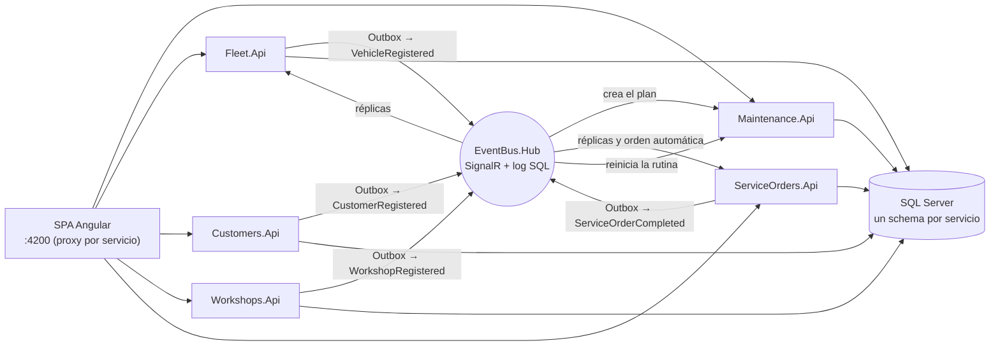

# RutaViva · Plataforma de mantenimiento preventivo de flotas

> CRM que detecta cuándo le toca mantenimiento a cada vehículo, por kilómetros o por tiempo, alerta al cliente y cierra el ciclo cuando se registra el servicio.

## Visión general

RutaViva rastrea flotas con GPS y sus clientes llevaban el mantenimiento en hojas de cálculo. Esta plataforma recibe las lecturas de odómetro y la revisión diaria por fecha, evalúa cada rutina (aceite, frenos, llantas…) contra su intervalo y su umbral, genera alertas sin duplicados y muestra el estado de la flota en una SPA. Está construida como microservicios por bounded context con DDD, Clean Architecture y CQRS, y se comunica por un EventBus propio con Outbox.

## Alcance del MVP

| Regla del reto | Estado | Dónde |
|---|---|---|
| RN-1 y RN-2: vencimiento por km o por tiempo, el que ocurra primero, con aviso «por vencer» por umbral | Implementado | [maintenance-core](openspec/changes/maintenance-core/) |
| RN-5: el servicio realizado reinicia el ciclo de la rutina y resuelve sus alertas | Implementado: al completar la orden de servicio o con el registro manual del operador ([ADR-0029](docs/adr/adr-0029-scope-mvp-service-record-without-service-orders.md)) | Maintenance |
| RN-6: lecturas repetidas o fuera de orden se ignoran sin efectos | Implementado | Maintenance ([ADR-0014](docs/adr/adr-0014-data-odometer-ingestion-acl.md)) |
| Clientes, aprobadores, talleres y vehículos con carga masiva | Implementado | [supporting-contexts](openspec/changes/supporting-contexts/) |
| RN-3: una orden por vencimiento, automática al vencer, como máximo una abierta por rutina y manual si la anterior se canceló | Implementado ([ADR-0031](docs/adr/adr-0031-int-service-orders-replicas-automatic-orders.md)) | ServiceOrders |
| RN-4: cotización del taller, aprobación por encima del tope por el dueño o el responsable, rechazo y cancelación | Implementado con tope global ([ADR-0030](docs/adr/adr-0030-scope-minimal-service-orders-mvp.md)); citas, servicios adicionales y políticas por cliente en la siguiente fase | ServiceOrders, [service-orders-core](openspec/changes/service-orders-core/) |
| ApiGateway, notificaciones en tiempo real, reportes e importación con asistente | Siguiente fase | [edge-gateway-notifications](openspec/changes/edge-gateway-notifications/), [reporting](openspec/changes/reporting/), [data-import](openspec/changes/data-import/) |

## Componentes

| Componente | Tipo | Ruta | Puerto local | Estado |
|---|---|---|---|---|
| `RutaViva.Maintenance.Api` | API REST | `src/Services/Maintenance` | 5101 | Activo |
| `RutaViva.Fleet.Api` | API REST | `src/Services/Fleet` | 5102 | Activo |
| `RutaViva.Customers.Api` | API REST | `src/Services/Customers` | 5103 | Activo |
| `RutaViva.Workshops.Api` | API REST | `src/Services/Workshops` | 5104 | Activo |
| `RutaViva.ServiceOrders.Api` | API REST | `src/Services/ServiceOrders` | 5105 | Activo |
| `RutaViva.EventBus.Hub` | Hub SignalR + log de eventos en SQL | `src/Platform/EventBus` | 5100 | Activo |
| `rutaviva-fleet-maintenance-ui` | SPA Angular ([README](src/Web/rutaviva-fleet-maintenance-ui/README.md)) | `src/Web` | 4200 | Activo |
| `RutaViva.BuildingBlocks.*` e `IntegrationContracts` | Librerías compartidas | `src/BuildingBlocks`, `src/Contracts` | — | Activo |

## Arquitectura



- **Un servicio por bounded context** con capas Domain, Application, Infrastructure y Api ([ADR-0010](docs/adr/adr-0010-arch-microservices-by-bounded-context.md)). Las pruebas de arquitectura con NetArchTest impiden dependencias entre servicios y hacia capas externas.
- **Consistencia entre servicios por eventos**: cada servicio escribe sus eventos en su Outbox en la misma transacción, un relay los publica en el EventBus y los suscriptores avanzan con checkpoint idempotente ([ADR-0024](docs/adr/adr-0024-int-eventbus-signalr-sql-log.md)).
- **Dominio rico**: agregados con invariantes, objetos de valor, `Result<T>` en lugar de excepciones de negocio y políticas puras de evaluación por dimensión (Strategy).
- **Una base de datos, un schema por servicio** ([ADR-0013](docs/adr/adr-0013-data-sqlserver-schema-per-service.md)); migraciones EF Core por servicio.
- Diseño completo por change en [`openspec/changes/`](openspec/changes/) y 31 decisiones en el [registro de ADRs](docs/adr/README.md).

## Requisitos previos

| Herramienta | Versión | Para qué |
|---|---|---|
| .NET SDK | 10.0.401 ([`global.json`](global.json)) | Servicios y pruebas |
| Node.js | 22.22 o superior (probado con 24.15) | SPA Angular 22 |
| PowerShell | 5.1 o superior | Scripts de arranque y carga |
| SQL Server local con autenticación de Windows | 2019 o superior | Solo para las pruebas de integración ([ADR-0027](docs/adr/adr-0027-proc-integration-tests-local-sqlserver.md)) |

## Puesta en marcha

```powershell
git clone https://github.com/dmazo1023/rutaviva-fleet-maintenance-platform.git
cd rutaviva-fleet-maintenance-platform
dotnet tool restore

# Compila, aplica las migraciones y levanta los 6 servicios y la SPA
.\deploy\local\start-all.ps1

# Carga los datos de la demo por los endpoints masivos (talleres, clientes, aprobadores, vehículos y rutinas)
.\deploy\local\load-demo-data.ps1
```

Abre http://localhost:4200. Para detener todo: `.\deploy\local\stop-all.ps1`. Los logs quedan en `deploy/local/logs/`.

> [!NOTE]
> Los servicios apuntan a la base SQL Server compartida configurada en los `appsettings.json` y en [`start-all.ps1`](deploy/local/start-all.ps1) (parámetro `-ConnectionString`). Si la base ya tiene las migraciones y los datos, usa `.\deploy\local\start-all.ps1 -SkipMigrations` y omite la carga. `start-all.ps1` busca Node en `%APPDATA%\nvm\v24.15.0`; si está en otra ruta, pásala con `-NodePath`.

## Recorrido de la demo

Los datos de [`samples/import/`](samples/import/) producen, evaluados el 2026-11-12, **4 rutinas por vencer y 4 vencidas** ([resultado esperado](samples/README.md)).

1. **Flota**: filtra por estado y busca por placa o modelo. La columna «Próximo mantenimiento» muestra la rutina más urgente y lo que le resta (por ejemplo, TAN202 «Cambio de aceite, −23 d»).
2. **Detalle del vehículo** (clic en una placa): cada rutina muestra su avance por km y por tiempo con el umbral de aviso. «Ajustar» cambia el intervalo o el porcentaje de la rutina con vista previa.
3. **Crear orden** en una rutina vencida (perfil Operador, por ejemplo TAN202): se abre el detalle de la orden. Una segunda orden para la misma rutina se rechaza mientras la primera esté abierta (RN-3). Las rutinas que vencen a partir de ahora generan su orden **automática** sola (etiqueta «Automática»): pruébalo en el **Simulador** con una lectura que deje vencida una rutina por vencer.
4. **Órdenes** (cambia el perfil arriba a la derecha): como **Taller**, «Cotizar» con un valor mayor a 1.000.000 deja la orden «Por aprobar» (RN-4); como **Aprobador** (elige en la barra superior un aprobador del dueño del vehículo; otro cliente recibe un rechazo), «Aprobar» o «Rechazar»; el Operador puede «Cancelar» la orden; de nuevo como **Taller**, «Iniciar» y «Completar» con el kilometraje. Al completar, Maintenance reinicia la rutina y resuelve la alerta (RN-5). Los mismos pasos están en [`samples/http/service-orders.http`](samples/http/service-orders.http).
5. **Registrar servicio realizado**: alternativa del operador para cerrar una rutina sin orden.
6. **Alertas**: bandeja con filtros Activas, Atendidas y Resueltas; «Atender» marca la alerta.
7. **Simulador** (perfil Operador): envía una lectura de odómetro (los casos de [`samples/http/odometer-readings.http`](samples/http/odometer-readings.http)) o ejecuta la revisión diaria para una fecha y observa los cambios.

## Pruebas

| Suite | Comando | Cobertura |
|---|---|---|
| Backend (unitarias, integración, arquitectura y contratos) | `dotnet test --solution RutaViva.slnx --max-parallel-test-modules 4` | 1394 pruebas |
| SPA | `npm test` y `npm run lint` en `src/Web/rutaviva-fleet-maintenance-ui` | 104 pruebas |

Las pruebas de integración crean y borran una base desechable por clase en el SQL Server local (cadena configurable con la variable `RUTAVIVA_TEST_SQL`). Incluyen el escenario completo de la demo y la idempotencia de RN-5. Las reglas de estilo del proyecto se aplican en la compilación: sin `var` (IDE0008 como error), analizadores con *warnings as errors* y snapshots de los contratos de integración.

## Estructura del repositorio

```
├── src/
│   ├── BuildingBlocks/     # Dominio, Application, Infrastructure, Api y cliente del EventBus compartidos
│   ├── Contracts/          # Eventos de integración V1 y contratos masivos
│   ├── Platform/           # EventBus (Hub, Application, Infrastructure) y ServiceDefaults
│   ├── Services/           # Customers, Workshops, Fleet y Maintenance (4 capas cada uno)
│   └── Web/                # SPA rutaviva-fleet-maintenance-ui
├── tests/                  # Pruebas por proyecto, arquitectura, contratos y fixtures
├── openspec/changes/       # Specs, diseño y tareas por change (SDD con OpenSpec)
├── docs/                   # ADRs, análisis del reto, modelo de datos y diseño UX aprobado
├── samples/                # CSV de la carga inicial y peticiones HTTP de la demo
└── deploy/local/           # Scripts de arranque, carga y SQL de referencia
```

## Documentación

- [Análisis del reto](docs/architecture/analisis-del-reto.md) y [modelo de datos](docs/architecture/data-model.md)
- [Registro de decisiones (ADR-0001 a ADR-0031)](docs/adr/README.md)
- [Diseño UX aprobado](docs/ux/crm-flota.mockup.html) y [handoff](docs/ux/crm-flota.handoff.md)
- Changes de OpenSpec: [foundation-platform](openspec/changes/foundation-platform/), [maintenance-core](openspec/changes/maintenance-core/), [supporting-contexts](openspec/changes/supporting-contexts/), [fleet-maintenance-ui](openspec/changes/fleet-maintenance-ui/)

## Stack tecnológico

| Capa | Tecnología |
|---|---|
| Backend | .NET 10, C# 14, ASP.NET Core Minimal API, EF Core 10.0.15, SQL Server |
| Aplicación | CQRS sin MediatR con decoradores, FluentValidation 12.2.0, Scrutor 7.0.0, Polly 8.9.1 |
| Mensajería | EventBus propio sobre SignalR 10.0.15 con log en SQL, Outbox y checkpoints |
| Observabilidad | OpenTelemetry 1.20.1, health checks `/health` y `/alive` |
| Pruebas | xUnit v3 4.0.3, AwesomeAssertions 9.6.0, NSubstitute 6.2.0, NetArchTest 1.3.2 |
| Frontend | Angular 22 (standalone, signals, zoneless), TypeScript 6, Vitest 5, SignalR client 11 |
