> **Revisión 2026-11-10 (en estado Proposed):** se incorporan los supuestos acordados A-05, A-06, A-07, A-10, A-11, A-14, A-15 (estado **En sitio** y aprobación prioritaria), A-18 y A-19.

## Contexto

- RN-4 define el flujo **Creada → Cotizada → Aprobada → En ejecución → Completada**, más **Cancelada**. Una cotización mayor a 1.500.000 COP requiere la aprobación del cliente; una igual o menor se aprueba automáticamente. El rechazo cancela, y el cliente puede cancelar antes de «En ejecución».
- Acuerdos con el equipo:
  - Existe el estado explícito de **espera de aprobación** (A-05).
  - El **monto de aprobación automática se parametriza en la BD**, se edita desde la web y aplica desde la siguiente cotización (A-06).
  - Hay **una sola cotización**, pero el aprobador puede pedir **servicios adicionales**, que el **taller cotiza** (A-10).
  - Aprueba **el dueño del vehículo** (cualquiera de sus aprobadores activos) **o el responsable asignado** (A-11).
  - Una rutina vencida cuya orden se canceló puede generar una **orden manual** (A-07).
  - Si el **vehículo se inactiva**, las órdenes abiertas se **pausan** (A-18).
  - El taller marca la orden **«En sitio»** cuando el vehículo llega. **Solo en ese estado** puede agregar servicios adicionales, y entonces la orden **vuelve a aprobación con prioridad alta** (A-15).
- El equipo usa las etiquetas **En sitio**, **En proceso**, **Finalizada** y **Cancelada** para el seguimiento de la orden en el taller.
- El equipo requiere una **cita con el taller** antes de que el vehículo llegue, en una versión mínima (ADR-0021).
- Hay 9 estados y 16 acciones ejecutadas por 3 actores: el taller, el aprobador o responsable, y el sistema.

## Decisión

Implementaremos el ciclo de vida **dentro del agregado `ServiceOrder`** con un enum `ServiceOrderStatus`, **métodos con intención de negocio** y una **tabla declarativa de transiciones** (estado → acciones permitidas), verificada por un único método de guarda `EnsureCanExecute(ServiceOrderAction action)`.

| Código | Etiqueta en el CRM |
|---|---|
| `Created` | Creada |
| `Quoted` | Cotizada (transitorio) |
| `PendingApproval` | Pendiente de aprobación |
| `Approved` | Aprobada |
| `OnSite` | **En sitio** |
| `InProgress` | **En proceso** |
| `OnHold` | En pausa |
| `Completed` | **Finalizada** |
| `Cancelled` | **Cancelada** |

```mermaid
stateDiagram-v2
    [*] --> Created: Create (Automatic | Manual)
    Created --> Quoted: Quote (taller, líneas con precio)
    Quoted --> Approved: total ≤ política vigente (automático)
    Quoted --> PendingApproval: total > política vigente [Reason=Quote, Priority=Normal]
    PendingApproval --> PendingApproval: RequestAdditionalService (aprobador) / PriceAdditionalService (taller)
    PendingApproval --> Approved: Approve [Reason=Quote]
    PendingApproval --> Cancelled: Reject [Reason=Quote]
    Approved --> Approved: Schedule / RescheduleAppointment (taller, ADR-0021)
    Approved --> OnSite: MarkOnSite (taller, vehículo llegó; requiere cita)
    OnSite --> PendingApproval: AddAdditionalService (taller, con precio) [Reason=AdditionalServices, Priority=High]
    PendingApproval --> OnSite: Approve / Reject [Reason=AdditionalServices]
    OnSite --> InProgress: Start (taller)
    InProgress --> Completed: Complete (km y fecha finales)
    Created --> Cancelled: Cancel
    PendingApproval --> Cancelled: Cancel
    Approved --> Cancelled: Cancel
    OnSite --> Cancelled: Cancel
    Created --> OnHold: Hold (vehículo inactivo)
    PendingApproval --> OnHold: Hold
    Approved --> OnHold: Hold
    OnSite --> OnHold: Hold
    InProgress --> OnHold: Hold
    OnHold --> Created: Resume (vuelve al estado previo)
    OnHold --> PendingApproval: Resume
    OnHold --> Approved: Resume
    OnHold --> OnSite: Resume
    OnHold --> InProgress: Resume
    OnHold --> Cancelled: Cancel (si el previo < InProgress)
    Completed --> [*]
    Cancelled --> [*]
```

Elementos del modelo:

1. **`ServiceLine`** (entidad interna): `Type` (`Routine` | `Additional`), `Description`, `Amount` (nullable mientras está `PendingPricing`), `RequestedBy` (`Workshop` | `Approver`) y `ApprovalStatus` (`Approved` | `PendingApproval` | `Rejected`). El total de la orden suma las líneas con precio que no están rechazadas.
2. **`ApprovalRequest`** (VO en la orden mientras está `PendingApproval`): `Reason` (`Quote` | `AdditionalServices`) y `Priority` (`Normal` | `High`). El **motivo decide a dónde vuelve la orden**:
   - Aprobar con `Quote` → `Approved`. Rechazar con `Quote` → `Cancelled` (RN-4).
   - Aprobar con `AdditionalServices` → `OnSite`, con las líneas adicionales aprobadas. Rechazar con `AdditionalServices` → `OnSite`, con las líneas adicionales en `Rejected`. **La orden original no se cancela**, porque ya estaba aprobada.
3. **Aprobación prioritaria**: `AddAdditionalService` en `OnSite` emite `ServiceOrderApprovalRequested { Priority = High, Reason = AdditionalServices }`. Notifications lo envía al grupo del dueño y al responsable como **alerta prioritaria**. La bandeja de aprobaciones del CRM ordena por prioridad y antigüedad.
4. **`ApprovalPolicy`** (VO): el monto de aprobación automática vigente se lee **de la BD sin caché** y la orden guarda una copia al cotizar. Solo aplica al motivo `Quote`. Los servicios adicionales **siempre** requieren aprobación, sin importar el monto (A-15).
5. **`ApprovalAuthorizationPolicy`** (servicio de dominio): autoriza si el aprobador está activo **y** (pertenece al cliente dueño **o** es el `ResponsibleApproverId` del vehículo).
6. **`Quote(lines, policy)`** registra `Quoted` en el historial y transita en la misma operación a `Approved` (`AutoApproved = true`) o a `PendingApproval` (A-14).
7. **`Hold()`** y **`Resume()`** guardan y restauran `StatusBeforeHold`. Los disparan los eventos del vehículo (ADR-0020). Desactivar una **rutina** no afecta la orden (A-17).
8. Cada transición agrega una fila al **historial de la orden** y emite `ServiceOrderStatusChanged`.
9. **Cita con el taller** (ADR-0021): el VO `WorkshopAppointment` se registra o reprograma en `Approved` y es **precondición de `MarkOnSite`**.
10. **Solo el dueño o el responsable cancelan** (RN-4). El taller no tiene la acción `Cancel`: en su vista «Cancelada» es solo un estado visible.

## Consecuencias

| ID | Consecuencia | Tipo |
|---|---|---|
| POS-001 | Todas las combinaciones de estado y acción (9 × 16 = 144) se cubren con una prueba parametrizada sobre la tabla de transiciones | Positive |
| POS-002 | El taller no puede ampliar el alcance sin aprobación: cada servicio adicional pasa por el dueño o el responsable | Positive |
| POS-003 | Rechazar un servicio adicional no destruye la orden aprobada: el vehículo sigue en el taller con el alcance original | Positive |
| POS-004 | Las aprobaciones de servicios adicionales (el vehículo está detenido en el taller) se distinguen de las normales y se atienden primero | Positive |
| POS-005 | Cambiar el monto de aprobación automática es una fila nueva en `ApprovalPolicies`, sin despliegues y con efecto en la siguiente cotización | Positive |
| NEG-001 | Mientras haya líneas `PendingPricing` (pedidas por el aprobador), la aprobación queda bloqueada hasta que el taller las cotiza | Negative |
| NEG-002 | Cada servicio adicional detiene el avance (`OnSite` → `PendingApproval` → `OnSite`) hasta que se aprueba. La prioridad alta mitiga, pero no elimina, el tiempo de vehículo detenido | Negative |
| NEG-003 | Con 9 estados, la tabla de transiciones está en el límite de su legibilidad. Si los estados necesitaran comportamiento propio (SLA por estado), habría que migrar al patrón State | Negative |

## Alternativas consideradas

### ALT-001 — Patrón State de GoF (una clase por estado)

**Descripción**: Una clase por estado que implementa `IServiceOrderState`.

**Rejection rationale**: Los estados solo permiten o niegan acciones, más una regla de retorno según el motivo de aprobación. Una tabla de transiciones lo expresa en un solo lugar (KISS). Queda como evolución (NEG-003).

### ALT-002 — Un estado separado `PendingAdditionalApproval`

**Descripción**: Un estado distinto para la aprobación de servicios adicionales.

**Rejection rationale**: Duplicaría las transiciones de aprobación, rechazo, pausa y cancelación. Con un solo `PendingApproval` más el motivo y la prioridad, el lenguaje del CRM se mantiene («pendiente de aprobación») y la diferencia queda en datos.

### ALT-003 — Modelar la alerta prioritaria como `Alert` de Maintenance

**Descripción**: Reutilizar el agregado de alertas de rutina.

**Rejection rationale**: Las alertas de Maintenance pertenecen al ciclo de la rutina (RN-2). La aprobación pendiente pertenece a la orden. Mezclarlas acoplaría dos bounded contexts por un concepto de presentación.

## Notas de implementación

| ID | Nota |
|---|---|
| IMP-001 | `Money` es un `record` (`Amount` decimal, `Currency` ISO 4217). `ServiceRecord` es un VO con `ServicedKm` ≥ 0 y `ServicedAt` no futura |
| IMP-002 | Endpoints del taller: `/quote`, `/additional-services/{lineId}/price`, `/appointment`, `/on-site`, `/additional-services` (solo en `OnSite`), `/start` y `/complete`. Endpoints del aprobador: `/additional-services/requests`, `/approve`, `/reject` y `/cancel`. Endpoint manual: `POST /api/v1/service-orders` |
| IMP-003 | `GET /api/v1/service-orders/approvals?customerId=` devuelve la bandeja ordenada por `ApprovalPriority DESC, UpdatedAt ASC` |
| IMP-004 | La creación manual exige que la réplica `RoutineReference` esté `Overdue` y activa, que el vehículo esté activo y que no exista otra orden abierta |
| IMP-005 | La query de detalle devuelve `availableActions` según la tabla de transiciones, el perfil del usuario y el motivo de aprobación |

## Referencias

| ID | Referencia |
|---|---|
| REF-001 | Gamma et al. (1994). *Design Patterns*: patrón State (comportamiento) |
| REF-002 | adr-0011-arch-aggregates-cross-service-consistency · adr-0016-int-gateway-notifications-signalr · adr-0019-data-business-parameters-in-database · adr-0020-arch-activation-states-suspension-cascade |
| REF-003 | [Análisis del reto §5](../architecture/analisis-del-reto.md) |

---

> **Immutability Notice**: Once this ADR reaches `Accepted` status, its Context, Decision, and Consequences sections must not be modified. If circumstances change and the decision is no longer valid, create a new ADR with `supersedes: adr-0003` pointing to this document, and update the `superseded_by` field above. The only mutable field on an accepted ADR is `superseded_by`.
