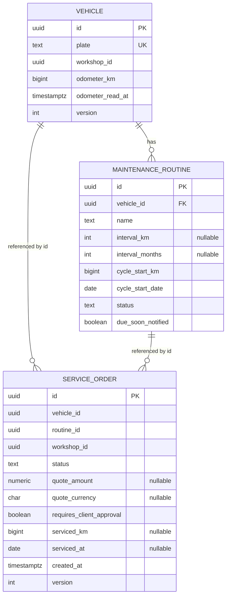

## Contexto

El enunciado deja fuera de alcance la «base de datos real» y permite persistir en memoria.

- El stack habitual de la compañía incluye un motor relacional, y el modelado de datos es una competencia valorada.
- El plazo efectivo es de unas 36 horas. Montar EF Core, migraciones, Docker Compose y pruebas con Testcontainers cuesta entre 4 y 6 horas estimadas.
- RN-3 exige una invariante de unicidad (máximo una orden abierta por vehículo y rutina) que, en un motor relacional, se puede reforzar con un índice.
- La demo se ejecuta desde un portátil y debe arrancar sin dependencias externas.
- Si hubiera dos procesos (por ejemplo, una API y una Azure Function), con persistencia en memoria **no compartirían estado**.

## Decisión

Persistiremos **en memoria** detrás de los puertos de repositorio definidos en Domain (`IVehicleRepository`, `IServiceOrderRepository`) y de `IUnitOfWork` en Application. **Además, entregaremos el esquema relacional diseñado** como artefacto de modelado, sin implementarlo como adaptador:

- `docs/architecture/data-model.md`: diagrama ER (Mermaid) y justificación de tipos e índices.
- `docs/architecture/schema.postgresql.sql`: el DDL de referencia, que incluye el índice único filtrado que refuerza RN-3.



```sql
CREATE UNIQUE INDEX ux_service_order_one_open_per_routine
    ON service_order (vehicle_id, routine_id)
    WHERE status NOT IN ('Completed', 'Cancelled');

ALTER TABLE maintenance_routine
    ADD CONSTRAINT ck_routine_has_interval
    CHECK (interval_km IS NOT NULL OR interval_months IS NOT NULL);
```

El adaptador en memoria replica la semántica de ese índice: `InMemoryServiceOrderRepository.Add` lanza `DuplicateOpenServiceOrderException` si ya existe una orden abierta para el par.

## Consecuencias

| ID | Consecuencia | Tipo |
|---|---|---|
| POS-001 | El sistema arranca con `dotnet run` en menos de 5 s, sin Docker ni cadenas de conexión | Positive |
| POS-002 | Se ahorran unas 5 horas que se invierten en el dominio, las pruebas y la UI, que son los criterios evaluados | Positive |
| POS-003 | Las invariantes de RN-3 tienen dos defensas: la transición única en el dominio (ADR-0002) y la unicidad en el repositorio, con su equivalente SQL documentado | Positive |
| POS-004 | Agregar un adaptador EF Core / PostgreSQL implica 0 cambios en Domain y Application: solo un nuevo `AddPostgresPersistence()` en Infrastructure | Positive |
| NEG-001 | Los datos se pierden al reiniciar. Se mitiga con un *seed* de demostración al arrancar (3 vehículos y 2 rutinas por vehículo) | Negative |
| NEG-002 | El esquema SQL no se valida en ejecución y puede desalinearse del modelo. Se mitiga dejándolo marcado como «referencia» y revisándolo en la misma PR que cambie el agregado | Negative |
| NEG-003 | Queda descartado ejecutar componentes en procesos separados que compartan estado (ver ADR-0006) | Negative |

## Alternativas consideradas

### ALT-001 — EF Core 10 + PostgreSQL en Docker Compose

**Descripción**: Un adaptador real con migraciones, `docker-compose.yml` y pruebas de integración con Testcontainers.

**Rejection rationale**: El enunciado lo excluye explícitamente. Costaría unas 5 horas de un plazo de 36 y agrega una dependencia de Docker en el portátil de la presentación. Se conserva como la evolución natural (POS-004) y como fase opcional si sobra tiempo.

### ALT-002 — EF Core con el proveedor InMemory

**Descripción**: Usar `UseInMemoryDatabase` como adaptador.

**Rejection rationale**: El proveedor InMemory no soporta índices únicos filtrados ni transacciones reales, y Microsoft desaconseja usarlo para simular una base de datos relacional. Daría una falsa sensación de persistencia relacional y agregaría el mapeo ORM sin beneficio.

### ALT-003 — SQLite en archivo

**Descripción**: Persistencia real ligera, sin servidor.

**Rejection rationale**: Implica el mismo costo de mapeo y migraciones que PostgreSQL, sin ser el motor de la compañía. Tampoco cumple la intención del enunciado de evitar una base de datos real.

## Notas de implementación

| ID | Nota |
|---|---|
| IMP-001 | Los repositorios en memoria se registran como `Singleton` y son seguros para concurrencia (`ConcurrentDictionary`). Guardan *snapshots* inmutables para no compartir referencias mutables de los agregados entre peticiones |
| IMP-002 | `InMemoryUnitOfWork` acumula los agregados modificados, los confirma y luego despacha sus eventos de dominio (ADR-0002, IMP-001) |
| IMP-003 | Las queries de lectura (CQRS) usan `IServiceOrderReadModel` y `IFleetReadModel` en Application, con implementación en memoria. No devuelven entidades de dominio |
| IMP-004 | El *seed* solo se ejecuta en `Development` (`DemoDataSeeder`, un `IHostedService`) |

## Referencias

| ID | Referencia |
|---|---|
| REF-001 | Microsoft Learn: *Testing without your production database system* (limitaciones del proveedor InMemory) |
| REF-002 | PostgreSQL 17 Docs: *Partial Indexes* |
| REF-003 | adr-0002-arch-aggregate-boundaries: invariante RN-3 |
| REF-004 | adr-0006-arch-daily-time-evaluation-host: restricción de un solo proceso |

---

> **Immutability Notice**: Once this ADR reaches `Accepted` status, its Context, Decision, and Consequences sections must not be modified. If circumstances change and the decision is no longer valid, create a new ADR with `supersedes: adr-0005` pointing to this document, and update the `superseded_by` field above. The only mutable field on an accepted ADR is `superseded_by`.
