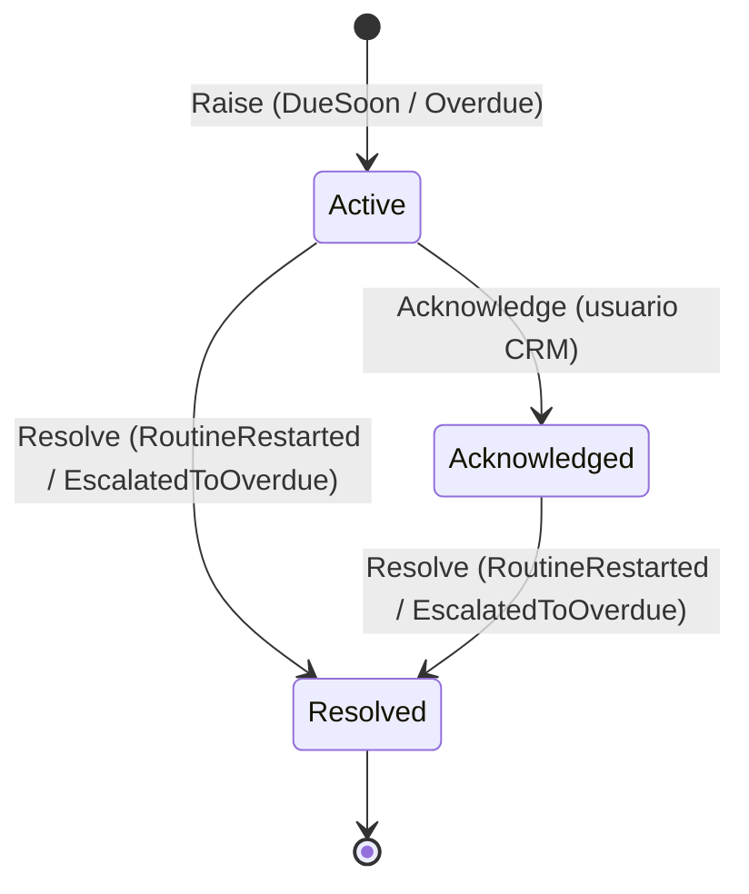

## Contexto

- El sistema debe funcionar como un CRM capaz de **recibir, gestionar y procesar alertas** de mantenimiento por km y por tiempo.
- RN-2 define el aviso «por vencer» (una sola vez por ciclo) y RN-3 el vencimiento.
- El enunciado no define estados para las alertas. El usuario del CRM necesita distinguir las alertas nuevas, las que ya se atendieron y las que se cerraron.
- Una alerta nace exactamente cuando una rutina cambia de estado, que es una regla del core domain de Maintenance.
- Una alerta pierde vigencia cuando la rutina se reinicia (RN-5) o cuando la alerta «por vencer» se convierte en «vencida».

## Decisión

Modelaremos `Alert` como un **agregado independiente dentro de Maintenance**, creado por los handlers internos de `MaintenanceRoutineDueSoon` y `MaintenanceRoutineOverdue` en la misma transacción que la rutina (ADR-0011).

- Atributos: `Type` (`DueSoon` u `Overdue`), `TriggeredBy` (`Distance`, `Time` o `DistanceAndTime`: km y tiempo tienen igual prioridad, A-04), `RoutineId`, `VehicleId`, `CycleNumber`, `RaisedAt`, `AcknowledgedAt` y `AcknowledgedBy`, `ResolvedAt` y `ResolutionReason`.
- **Salto directo** de `UpToDate` a `Overdue`: solo se crea la alerta `Overdue` (A-03).
- **Unicidad**: una alerta por `(RoutineId, CycleNumber, Type)`, en el dominio y con un índice único (RN-2, «una sola vez por ciclo»).
- **Resolución automática**: al emitirse `Overdue`, la `DueSoon` del mismo ciclo se resuelve con `EscalatedToOverdue`. Al consumir `ServiceOrderCompleted` y reiniciar la rutina, las alertas abiertas del ciclo se resuelven con `RoutineRestarted`. Si un cambio de parámetros devuelve la rutina a `UpToDate`, se resuelven con `ParametersChanged` (ADR-0019), y al desactivar la rutina con `RoutineDeactivated` (ADR-0020).
- La única acción manual es `Acknowledge`. No hay una resolución manual, porque la resolución la determina el negocio (YAGNI).
- Cada transición publica `AlertRaised` o `AlertStatusChanged` en `rutaviva.maintenance.alert.v1`.

## Consecuencias

| ID | Consecuencia | Tipo |
|---|---|---|
| POS-001 | La bandeja de alertas del CRM se filtra por estado con un índice `(Status, RaisedAt DESC)` | Positive |
| POS-002 | El aviso «una vez por ciclo» queda auditable: cada alerta guarda su ciclo, quién la atendió y por qué se resolvió | Positive |
| POS-003 | Las alertas no requieren un servicio aparte ni integración por red con la rutina que las origina | Positive |
| NEG-001 | Se agregan un estado y unas reglas que el enunciado no pide de forma explícita. Fueron validados con el equipo (A-12) | Negative |
| NEG-002 | Maintenance crece en responsabilidades (rutinas y alertas). Si las alertas sumaran canales o escalamientos, serían candidatas a un servicio propio | Negative |

## Alternativas consideradas

### ALT-001 — Microservicio Alerts independiente

**Descripción**: Un servicio que consume los eventos de las rutinas y gestiona las alertas.

**Rejection rationale**: Sería un servicio anémico, con un estado derivado de otro contexto, que además necesitaría su propio suscriptor idempotente para garantizar «una vez por ciclo». El ADR-0010 lo descarta como *entity service*.

### ALT-002 — Alertas sin estado (solo notificaciones efímeras)

**Descripción**: Publicar el evento y mostrar un *toast* sin persistir nada.

**Rejection rationale**: No satisface la gestión de alertas del CRM. Una alerta recibida con el usuario desconectado se perdería.

## Notas de implementación

| ID | Nota |
|---|---|
| IMP-001 | Endpoints: `GET /api/v1/alerts?status=Active&vehicleId=...` (query) y `POST /api/v1/alerts/{id}/acknowledge` (command) |
| IMP-002 | `AcknowledgedBy` es texto libre enviado por la UI, porque la autenticación está fuera de alcance. La evolución es tomarlo del token |

## Referencias

| ID | Referencia |
|---|---|
| REF-001 | adr-0011-arch-aggregates-cross-service-consistency: despacho interno en la misma transacción |
| REF-002 | [Modelo de datos](../architecture/data-model.md): `maintenance.Alerts` |
| REF-003 | [Análisis del reto §5](../architecture/analisis-del-reto.md): supuestos A-03 y A-12 |

---

> **Immutability Notice**: Once this ADR reaches `Accepted` status, its Context, Decision, and Consequences sections must not be modified. If circumstances change and the decision is no longer valid, create a new ADR with `supersedes: adr-0015` pointing to this document, and update the `superseded_by` field above. The only mutable field on an accepted ADR is `superseded_by`.
