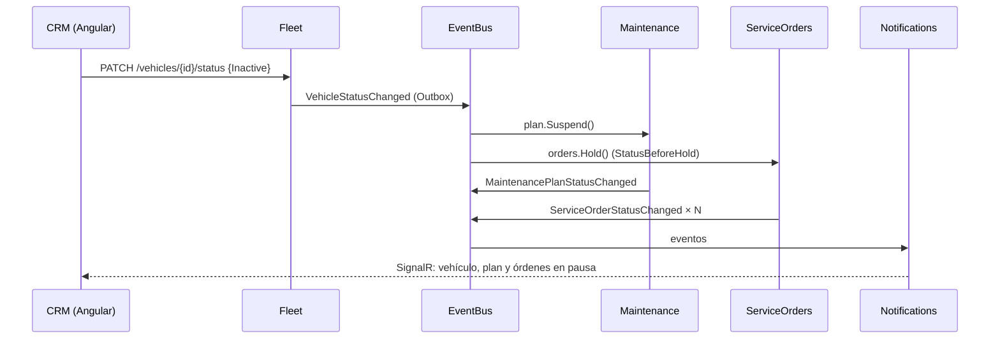

## Contexto

- El **vehículo** debe tener un estado. Si está **inactivo**, se deben **pausar sus órdenes y las validaciones diarias** (RQ-05).
- Las **rutinas** deben poder **activarse y desactivarse desde un panel** (RQ-04).
- El vehículo pertenece a Fleet, las evaluaciones a Maintenance y las órdenes a ServiceOrders (ADR-0010). Los servicios solo se comunican por eventos del EventBus (ADR-0024).
- Una rutina ya tiene un estado de vencimiento (`UpToDate`, `DueSoon`, `Overdue`). Mezclar el estado de activación con el de vencimiento en un solo campo produciría combinaciones ambiguas, como «¿inactiva y vencida?».
- Mientras un vehículo está inactivo, la telemetría puede seguir enviando lecturas.

## Decisión

Separaremos el **estado de activación** del **estado de negocio** y propagaremos la suspensión **por eventos**:

| Elemento | Estado de activación | Dueño | Efecto |
|---|---|---|---|
| Vehículo | `VehicleStatus.Active / Inactive` | Fleet (`Vehicle.Deactivate()`, `Reactivate()`) | Publica `VehicleStatusChanged` |
| Plan de mantenimiento | `MaintenancePlanStatus.Active / Suspended` | Maintenance (reacciona a `VehicleStatusChanged`) | **Suspended**: registra el odómetro (monotonía) pero **no evalúa** km ni tiempo, ni emite alertas. **Resume**: reevalúa con la fecha de hoy y el odómetro actual |
| Rutina | `RoutineState.Active / Inactive` (independiente de `RoutineDueStatus`) | Maintenance (`Deactivate()` y `Activate()` desde el panel) | **Inactive**: no se evalúa y sus alertas abiertas se resuelven con `RoutineDeactivated`. **No afecta** su orden abierta (A-17). **Active**: se reevalúa de inmediato |
| Órdenes abiertas del vehículo | `OnHold` + `StatusBeforeHold` | ServiceOrders (reacciona a `VehicleStatusChanged`) | **Inactivo** → `Hold()` en todas las órdenes abiertas. **Activo** → `Resume()` (A-18, A-19) |

- La suspensión es **idempotente**. Desactivar un vehículo ya inactivo no emite eventos, y reanudar una orden que no está `OnHold` no hace nada. Esto hace seguras las reentregas del EventBus.
- La réplica `serviceorders.VehicleReferences.Status` (`VehicleStatus.Inactive`) impide crear órdenes (automáticas o manuales) para un vehículo inactivo. Si llega un `MaintenanceRoutineOverdue` emitido justo antes de la desactivación (carrera), la orden se crea directamente en `OnHold`.

## Consecuencias

| ID | Consecuencia | Tipo |
|---|---|---|
| POS-001 | Fleet no conoce a Maintenance ni a ServiceOrders: agregar otro servicio que reaccione a la inactivación tiene 0 impacto en Fleet | Positive |
| POS-002 | El odómetro sigue siendo correcto durante la suspensión. Al reactivar, la evaluación usa el km real y no uno desactualizado | Positive |
| POS-003 | Las dos dimensiones de la rutina (activación y vencimiento) se prueban de forma independiente, sin combinaciones ambiguas | Positive |
| NEG-001 | La pausa es eventualmente consistente: durante unos cientos de milisegundos una orden puede seguir aceptando acciones del taller tras la inactivación | Negative |
| NEG-002 | Al reactivar, un vehículo inactivo durante meses puede generar varias alertas y órdenes a la vez | Negative |

## Alternativas consideradas

### ALT-001 — Un solo campo de estado en la rutina (`Inactive` como otro valor de vencimiento)

**Descripción**: `UpToDate | DueSoon | Overdue | Inactive`.

**Rejection rationale**: Al reactivar se perdería el estado de vencimiento previo, y el índice de alertas por ciclo dependería del estado de activación. Son dos conceptos con reglas distintas.

### ALT-002 — Llamada HTTP de Fleet a Maintenance y ServiceOrders para pausar

**Descripción**: Fleet orquesta la pausa con llamadas síncronas.

**Rejection rationale**: Acopla Fleet a dos servicios y, si uno está caído, la inactivación falla o queda a medias. Contradice ADR-0010 (sin HTTP entre servicios).

### ALT-003 — Cancelar las órdenes al inactivar el vehículo

**Descripción**: En lugar de pausar, cancelar.

**Rejection rationale**: El equipo pidió **pausar**. Cancelar perdería la cotización y la aprobación, y no se podría reanudar.

## Notas de implementación

| ID | Nota |
|---|---|
| IMP-001 | Endpoints: `PATCH /api/v1/fleet/vehicles/{id}/status` y `PATCH /api/v1/maintenance/plans/{vehicleId}/routines/{routineId}/state` |
| IMP-002 | `ReevaluateMaintenancePlansCommand` y los consumidores de telemetría y tiempo omiten los planes `Suspended` y las rutinas `Inactive` mediante un método de dominio (`plan.CanBeEvaluated`), no con filtros dispersos |
| IMP-003 | El panel de rutinas muestra las dos dimensiones: un interruptor de activación y una insignia del estado de vencimiento con el próximo mantenimiento (km y fecha) |

## Referencias

| ID | Referencia |
|---|---|
| REF-001 | adr-0003-arch-service-order-state-machine: estado `OnHold` |
| REF-002 | adr-0010-arch-microservices-by-bounded-context · adr-0024-int-eventbus-signalr-sql-log |
| REF-003 | [Análisis del reto §5](../architecture/analisis-del-reto.md): A-17, A-18, A-19 |

---

> **Immutability Notice**: Once this ADR reaches `Accepted` status, its Context, Decision, and Consequences sections must not be modified. If circumstances change and the decision is no longer valid, create a new ADR with `supersedes: adr-0020` pointing to this document, and update the `superseded_by` field above. The only mutable field on an accepted ADR is `superseded_by`.
