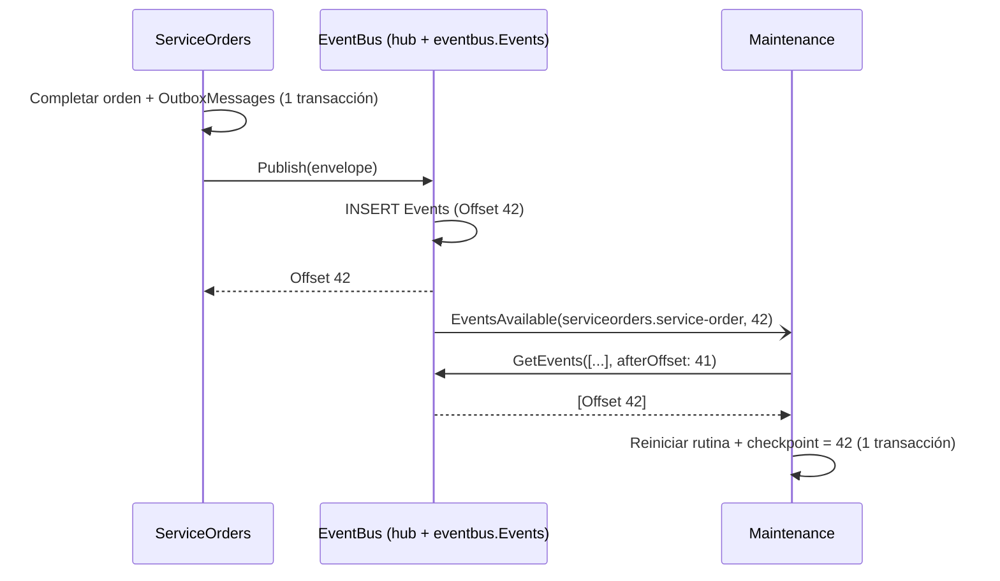

## Contexto

Este ADR reemplaza al ADR-0012, que usaba Kafka como bus de eventos entre microservicios.

- El equipo evaluó desplegar la solución en AWS: APIs, base de datos y SPA. Kafka en AWS implica operar un broker propio en una instancia (EC2), contratar un servicio gestionado (Amazon MSK, con costo por hora aunque esté inactivo) o depender de un tercero (Confluent Cloud o Redpanda).
- El equipo considera que Kafka agrega una complejidad desproporcionada para el plazo de entrega (jueves 2026-11-12, 05:00).
- La arquitectura de microservicios (ADR-0010) sigue necesitando comunicación asíncrona y desacoplada. Las réplicas locales, RN-3, RN-5, Notifications y Reporting dependen de eventos.
- SignalR ya forma parte del stack (Notifications, ADR-0016). Entrega mensajes a clientes conectados pero **no los persiste, no confirma su recepción y no los reintenta**. Un suscriptor que se reinicia pierde los mensajes enviados mientras estaba desconectado.
- Escribir en la base de datos y publicar un evento son dos operaciones sin transacción distribuida (*dual-write problem*). Este problema no depende del transporte.
- SQL Server ya está disponible y cada servicio tiene su schema (ADR-0013).

## Decisión

Crearemos el servicio **`RutaViva.EventBus.Hub`**, con una única responsabilidad: **recibir, guardar y repartir eventos de integración**. Usa **SignalR como canal de aviso** y **SQL Server como log de eventos** (schema `eventbus`).

**1. Streams (equivalente a los topics)**

Un *stream* agrupa los eventos de un agregado. Se conservan los nombres del ADR-0012, sin el prefijo de transporte:

| Stream | Productor | Suscriptores |
|---|---|---|
| `customers.customer` | Customers | Fleet, ServiceOrders, Reporting |
| `workshops.workshop` | Workshops | Fleet, Reporting |
| `fleet.vehicle` | Fleet | Maintenance, ServiceOrders, Reporting |
| `maintenance.routine` | Maintenance | ServiceOrders, Notifications, Reporting |
| `maintenance.alert` | Maintenance | Notifications, Reporting |
| `serviceorders.service-order` | ServiceOrders | Maintenance, Notifications, Reporting |

La telemetría y la revisión por fecha dejan de ser eventos. Llegan a Maintenance por HTTP (ADR-0014 y ADR-0017).

**2. Log de eventos**: `eventbus.Events` con `Offset` (`bigint identity`, PK), `MessageId` (único), `Stream`, `Type`, `Subject`, `OccurredAt`, `StoredAt` y `Payload` (envelope CloudEvents 1.0 en JSON). Los eventos no se borran: el log es la fuente para volver a procesar.

**3. Publicación (Transactional Outbox, sin cambios)**

- El evento se escribe en `{schema}.OutboxMessages` en la misma transacción que el cambio de estado.
- `OutboxRelayService` invoca el método `Publish(envelope)` del hub interno `/internal/hubs/events`.
- El hub inserta el evento y responde con su `Offset`. Solo entonces el relay marca el mensaje como enviado.
- Si el `MessageId` ya existe, el hub responde con el `Offset` existente. Así, la publicación es idempotente ante reintentos del relay.
- Las inserciones se serializan con un único escritor (`SemaphoreSlim(1)`). El orden de confirmación coincide con el `Offset`, y ningún suscriptor puede ver el offset 11 antes que el 10.

**4. Consumo: SignalR avisa, el suscriptor lee**

- Después de guardar, el hub envía al grupo `stream:{Stream}` solo un **aviso** `EventsAvailable(stream, offset)`, sin el contenido del evento.
- Cada suscriptor ejecuta **un único bucle secuencial**: lee con `GetEvents(streams, afterOffset, max: 100)` en orden de `Offset` y procesa cada evento.
- El bucle se despierta con un aviso, al conectarse o reconectarse, y cada 5 s como respaldo si se pierde un aviso.
- Como los datos siempre se leen del log, una desconexión no pierde eventos, y no hay carrera entre el aviso en vivo y la recuperación de los atrasados.

**5. Checkpoint e idempotencia**

- Cada suscriptor guarda `{schema}.EventCheckpoints(SubscriberName, LastOffset)` **en la misma transacción** que el efecto del evento.
- Un evento con `Offset <= LastOffset` ya fue procesado y se omite.
- Este checkpoint **reemplaza a la tabla Inbox** del ADR-0012: el procesamiento es secuencial y el log no admite `MessageId` repetidos, así que el offset basta.

**6. Errores**

- Si un handler falla, se reintenta 3 veces con *backoff* (1 s, 2 s y 4 s).
- Si sigue fallando, el suscriptor reporta `ReportFailure(subscriber, offset, error)`. El hub lo guarda en `eventbus.DeadLetters` y el suscriptor avanza su checkpoint para no bloquear el stream.

**7. Volver a procesar**: un suscriptor nuevo, o uno con el checkpoint reiniciado a 0, recorre todo el log. Notifications es la excepción: arranca desde `GetLatestOffset()`, porque un aviso viejo no tiene valor para la web.

**8. Aislamiento**

- El Gateway **no** enruta `/internal/**`. EventBus solo es accesible desde la red interna (en AWS, una subred privada con un *security group* que solo admite a los servicios).
- El usuario de base de datos `eventbus_app` solo tiene permisos sobre el schema `eventbus`.

## Consecuencias

| ID | Consecuencia | Tipo |
|---|---|---|
| POS-001 | No hay broker que operar: en local y en AWS solo existen APIs .NET, SQL Server y la SPA | Positive |
| POS-002 | Cero eventos perdidos ante la caída de un productor (Outbox), del EventBus (el relay reintenta) o de un suscriptor (recupera desde su checkpoint) | Positive |
| POS-003 | Agregar un suscriptor nuevo supone 0 cambios en los productores. El productor no conoce a los suscriptores | Positive |
| POS-004 | El orden es global por `Offset`, más estricto que el orden por partición de Kafka: los eventos de un mismo agregado nunca se procesan desordenados | Positive |
| POS-005 | Reporting reconstruye sus proyecciones reiniciando su checkpoint a 0 | Positive |
| POS-006 | El transporte queda detrás de `IIntegrationEventPublisher` e `IIntegrationEventHandler<T>`. Volver a Kafka o pasar a SNS/SQS es escribir un adaptador en BuildingBlocks, con 0 cambios en Domain y Application | Positive |
| NEG-001 | Es código propio que hay que mantener (hub, log, cliente de suscripción): unas 2 a 3 horas más que una integración HTTP directa | Negative |
| NEG-002 | El único escritor limita el rendimiento a unos cientos de eventos por segundo. Es suficiente porque la telemetría no pasa por el bus | Negative |
| NEG-003 | Una sola instancia de EventBus y una sola instancia por suscriptor. No hay grupos de consumidores con varias réplicas | Negative |
| NEG-004 | Latencia de un evento: el relay del Outbox (hasta 500 ms) más el aviso y la lectura (decenas de ms). Si se pierde el aviso, hasta 5 s más | Negative |
| NEG-005 | El log crece sin límite. Con el volumen de la demo es irrelevante. La evolución es una retención por fecha, que deshabilita volver a procesar más atrás de ese punto | Negative |
| NEG-006 | Sin autenticación entre servicios, la protección del hub interno depende de la red | Negative |

## Alternativas consideradas

### ALT-001 — Mantener Kafka (ADR-0012)

**Descripción**: Broker Kafka en Docker en local, y en AWS en una EC2, Amazon MSK o Confluent Cloud.

**Rejection rationale**: El equipo lo considera demasiado complejo para el plazo. En AWS obliga a operar un broker o a pagar un servicio gestionado por hora aunque esté inactivo. Sigue siendo la evolución natural si el volumen crece (POS-006).

### ALT-002 — HTTP entre servicios con Outbox (push a URLs configuradas)

**Descripción**: El relay del Outbox hace `POST` a la URL de cada suscriptor configurado.

**Rejection rationale**: El productor tiene que conocer a todos sus suscriptores, así que agregar uno cambia la configuración del productor. Además, no hay log central para volver a procesar, y Reporting no podría reconstruir sus proyecciones.

### ALT-003 — SignalR puro, sin persistencia

**Descripción**: El productor envía el evento al hub y el hub lo reenvía a los conectados.

**Rejection rationale**: Un suscriptor desconectado pierde el evento. Si Maintenance se reinicia cuando una orden se finaliza, la rutina nunca vuelve a «Al día» (RN-5), y lo mismo ocurre con la creación de órdenes (RN-3).

### ALT-004 — Amazon SNS + SQS FIFO

**Descripción**: Un tópico SNS por stream y una cola SQS FIFO por suscriptor.

**Rejection rationale**: Ata la ejecución local a AWS o a un emulador (LocalStack). SQS borra el mensaje al consumirlo, así que no hay forma de volver a procesar. Queda como adaptador futuro (POS-006).

## Notas de implementación

| ID | Nota |
|---|---|
| IMP-001 | `BuildingBlocks.EventBus.Client`: `EventBusPublisher` (lo usa el relay del Outbox) y `EventBusSubscriberHost` (`BackgroundService` con `HubConnection.WithAutomaticReconnect()`, el bucle secuencial, el checkpoint y los reintentos). Cada servicio solo implementa `IIntegrationEventHandler<TEvent>` y declara sus streams |
| IMP-002 | Métodos del hub interno: `Publish(envelope) → offset`, `Subscribe(streams)` (unirse a los grupos), `GetEvents(streams, afterOffset, max)`, `GetLatestOffset()` y `ReportFailure(subscriber, offset, error)`. Los nombres viven como constantes en `RutaViva.IntegrationContracts.EventBus` |
| IMP-003 | El envelope CloudEvents 1.0 no cambia: `id` = `MessageId`, `source` = `/rutaviva/{service}`, `type` = `rutaviva.serviceorders.ServiceOrderStatusChanged.v1`, `subject` = ID del agregado y `data`. Se agrega la extensión `traceparent` para las trazas (ADR-0018) |
| IMP-004 | Las pruebas de arquitectura verifican que Application no referencia `Microsoft.AspNetCore.SignalR.Client` |
| IMP-005 | Prueba de integración clave: detener Maintenance, finalizar 3 órdenes, arrancar Maintenance y verificar que las 3 rutinas vuelven a «Al día» exactamente una vez |
| IMP-006 | En AWS, EventBus se despliega como una API más (ECS Fargate o la misma EC2), sin balanceador público |

## Referencias

| ID | Referencia |
|---|---|
| REF-001 | Richardson, C. *Pattern: Transactional outbox* e *Idempotent Consumer* (microservices.io) |
| REF-002 | Kleppmann, M. (2017). *Designing Data-Intensive Applications*, cap. 11: logs de eventos y offsets de consumidores |
| REF-003 | Microsoft Learn: *ASP.NET Core SignalR .NET client* y *Manage users and groups in SignalR* |
| REF-004 | CloudEvents 1.0 Specification |
| REF-005 | adr-0012-int-kafka-event-backbone-outbox-inbox: decisión reemplazada |

---

> **Immutability Notice**: Once this ADR reaches `Accepted` status, its Context, Decision, and Consequences sections must not be modified. If circumstances change and the decision is no longer valid, create a new ADR with `supersedes: adr-0024` pointing to this document, and update the `superseded_by` field above. The only mutable field on an accepted ADR is `superseded_by`.
