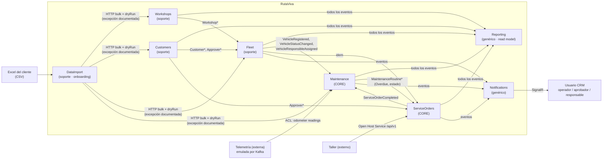
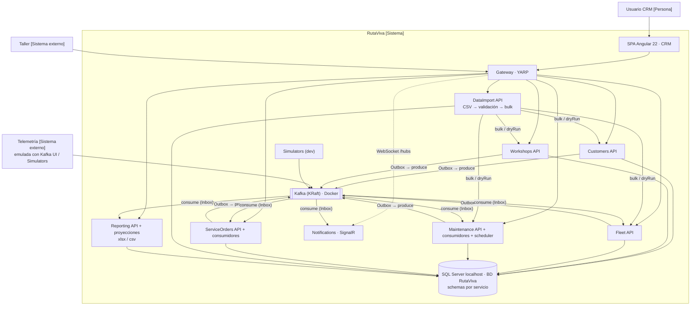

# Análisis del reto técnico — RutaViva: CRM de Mantenimiento Preventivo

> Documento de análisis previo a la implementación. Las decisiones están en [`docs/adr/`](../adr/README.md). El modelo de datos está en [`data-model.md`](data-model.md).
> Fecha: 2026-11-10 · Entrega: jueves 2026-11-12, antes de las 05:00 a. m. (último commit y enlace).
> **Revisión 2:** microservicios, Kafka, SQL Server y CRM (ADR-0010 a 0018).
> **Revisión 3:** supuestos A-01 a A-13 resueltos con el equipo, nuevos requisitos RQ-01 a RQ-06 (ADR-0019 y 0020).

---

## 1. Lectura del problema en una frase

RutaViva necesita un **CRM de mantenimiento preventivo**. Allí se gestionan clientes (dueños) y sus aprobadores, talleres, vehículos con su estado y su responsable, rutinas activables y una **matriz de parámetros editable desde la web**. El sistema **procesa eventos de telemetría y de tiempo** que llegan por Kafka y los convierte en **alertas gestionables**. Cada vencimiento genera **una única orden de servicio**, con cotización por líneas, servicios adicionales y aprobación por umbral parametrizable. Cada cambio se refleja **en tiempo real** en la web.

---

## 2. Drivers de arquitectura (ADD, paso 1)

| Categoría | Driver | Impacto en el diseño |
|---|---|---|
| Restricción de negocio | Entrega en **~28 horas** de trabajo efectivo | Cortes verticales priorizados (§10) |
| Restricción técnica | Kafka, SQL Server localhost (una BD, un schema por servicio), .NET 10, Angular 22, SignalR | ADR-0010, 0012, 0013, 0016 |
| Calidad técnica | Responsabilidad única por servicio | Microservicios por bounded context (ADR-0010) |
| Calidad técnica | Corrección ante eventos *at-least-once*, duplicados o fuera de orden | Outbox, Inbox y monotonía (ADR-0012, ADR-0014) |
| Calidad de negocio | **Modificabilidad en caliente**: umbral «por vencer» por rutina y monto de aprobación automática editables sin desplegar | Parámetros en la BD, administrables desde la web y sin caché (ADR-0019) |
| Calidad de negocio | El usuario del CRM ve los cambios del taller y de los parámetros al instante | Gateway y Notifications con SignalR (ADR-0016). Botón «Actualizar» para las ediciones directas en SQL (ADR-0019) |
| Funcional | Estados de vehículo y de rutina con efecto en cascada (pausar órdenes y evaluaciones) | ADR-0020 |
| Funcional | RN-1 a RN-6, alertas con estados, servicios adicionales y aprobación por el dueño o el responsable | ADR-0003, ADR-0011, ADR-0015 |

---

## 3. Lenguaje ubicuo (español → código en inglés)

| Negocio | Código | Servicio dueño |
|---|---|---|
| Cliente (dueño del vehículo; RutaViva también es un cliente) / aprobador | `Customer`, `Approver` | Customers |
| Taller | `Workshop` | Workshops |
| Vehículo, estado (activo/inactivo), responsable asignado | `Vehicle`, `VehicleStatus`, `ResponsibleApproverId` | Fleet |
| Tipo de rutina (matriz de parámetros) | `RoutineType` (intervalos por defecto, % «por vencer») | Maintenance |
| Plan de mantenimiento (odómetro + rutinas), plan suspendido | `MaintenancePlan`, `MaintenancePlanStatus.Active / Suspended` | Maintenance |
| Rutina: estado de activación y estado de vencimiento | `RoutineState.Active / Inactive`, `RoutineDueStatus.UpToDate / DueSoon / Overdue` | Maintenance |
| Próximo mantenimiento (km y fecha) | `NextDue` (VO calculado) | Maintenance |
| Alerta: activa / atendida / resuelta | `Alert`, `AlertStatus` | Maintenance |
| Orden de servicio: creada, cotizada, pendiente de aprobación, aprobada, **en sitio**, **en proceso**, en pausa, **finalizada**, **cancelada** | `ServiceOrderStatus.Created / Quoted / PendingApproval / Approved / OnSite / InProgress / OnHold / Completed / Cancelled` | ServiceOrders |
| Solicitud de aprobación (motivo y prioridad) | `ApprovalRequest` (`Quote` / `AdditionalServices`, `Normal` / `High`) | ServiceOrders |
| Línea de servicio (rutina o adicional), pendiente de precio | `ServiceLine`, `ServiceLineType`, `PricingStatus` | ServiceOrders |
| Política de aprobación automática (vigente desde) | `ApprovalPolicy` | ServiceOrders |

---

## 4. Reglas de negocio → dónde viven

| Regla | Servicio · dueño en el modelo | Evento de integración |
|---|---|---|
| RN-1: km, tiempo o ambos con la **misma prioridad**; vence lo primero | Maintenance · `MaintenanceInterval.Evaluate(...)` (estado más severo; registra si lo disparó km, tiempo o ambos) | — |
| RN-2: por vencer al **% configurado por tipo de rutina** (10 % por defecto), aviso una vez por ciclo | Maintenance · `MaintenanceRoutine.Reevaluate(...)` con el `DueSoonThreshold` del `RoutineType` o el ajuste de la rutina | `MaintenanceRoutineDueSoon`, `AlertRaised` |
| RN-3: una orden por vencimiento; máximo una abierta. **Creación manual** si la orden anterior se canceló | Maintenance emite `MaintenanceRoutineOverdue`. ServiceOrders crea la orden automática o manual (índice único filtrado) | `ServiceOrderCreated` |
| RN-4: flujo, umbral parametrizable, rechazo y cancelación; **servicios adicionales**; **aprueba el dueño o el responsable** | ServiceOrders · `ServiceOrder`, `ApprovalPolicy`, `ApprovalAuthorizationPolicy` (ADR-0003) | `ServiceOrderStatusChanged`, `ServiceOrderApprovalRequested` |
| RN-5: completar con el **km y la fecha finales** recalcula el próximo mantenimiento | ServiceOrders → `ServiceOrderCompleted` → Maintenance `RestartRoutine(...)`. `NextDue = km del servicio + intervalo / fecha + meses` | `MaintenanceRoutineRestarted` |
| RN-6: el odómetro nunca disminuye | Maintenance · `Odometer.IsAdvancedBy(...)` | — |
| RQ-04/05: un vehículo inactivo pausa las órdenes y las evaluaciones; una rutina inactiva no se evalúa | Fleet → `VehicleDeactivated` → Maintenance `Suspend()` y ServiceOrders `Hold()` (ADR-0020) | `VehicleStatusChanged`, `ServiceOrderStatusChanged` |

---

## 5. Supuestos resueltos con el equipo

| # | Tema | Decisión acordada |
|---|---|---|
| A-01 | Línea base del primer ciclo | Al crear la rutina se indica el **km y la fecha del último servicio**. Si el vehículo es nuevo, arranca en **0 km** y en la fecha de alta |
| A-02 | Umbral «por vencer» | **Parametrizable por tipo de rutina** en una matriz SQL (`maintenance.RoutineTypes`), con un ajuste opcional por rutina del vehículo y editable desde la web. Los meses son meses de calendario |
| A-03 | Salto directo «al día → vencida» | **Solo se emite la alerta de vencida** |
| A-04 | Prioridad entre km y tiempo | **Igual prioridad**. La alerta indica `Distance`, `Time` o `DistanceAndTime` |
| A-05 | Estado de espera de aprobación | **Existe**: `PendingApproval` |
| A-06 | Monto de aprobación automática | Exactamente 1.500.000 COP **se aprueba automáticamente**. El monto se **parametriza en la BD** (`serviceorders.ApprovalPolicies`), se edita desde la web y aplica **desde la siguiente cotización** (cada orden guarda una copia del valor vigente) |
| A-07 | Rutina vencida tras una orden cancelada | No se crea otra orden automáticamente. El usuario puede **crear la orden manualmente** desde el CRM y el flujo inicia de nuevo |
| A-08 | Km al completar | El taller reporta el **km y la fecha finales**. La rutina reinicia su ciclo desde ahí y el próximo mantenimiento se calcula y se muestra. Si ese km es mayor que el odómetro, también lo actualiza (monotonía) |
| A-09 | Lecturas fuera de orden | Se comparan **por km** (RN-6). No requería decisión |
| A-10 | Cotizaciones | **Una sola cotización** (con líneas). Mientras la orden está en `PendingApproval`, el **aprobador** puede pedir servicios adicionales y **el taller les pone precio**. El total se recalcula |
| A-11 | Quién aprueba | El **dueño del vehículo** (un `Customer`, que puede ser la propia RutaViva) por medio de cualquiera de sus aprobadores activos, **o el responsable asignado** al vehículo |
| A-12 | Ciclo de vida de una alerta | `Active → Acknowledged → Resolved`. La resolución es automática |
| A-13 | Lectura de un vehículo desconocido | Se **reintenta unos segundos** (carrera de tiempos con `VehicleRegistered`) y luego **se ignora y se registra en el log**. No va a la DLQ |

### Interpretaciones derivadas (a validar en la sustentación)

| # | Interpretación |
|---|---|
| A-14 | `Quoted` es un estado **transitorio**: la orden pasa inmediatamente a `Approved` (automática) o a `PendingApproval`. Queda registrado en el historial |
| A-15 | ✅ **Confirmado:** el taller marca la orden **«En sitio»** (`OnSite`) cuando llega el vehículo. **Solo en ese estado** puede agregar servicios adicionales, y la orden vuelve a `PendingApproval` con **prioridad alta** (alerta prioritaria al dueño y al responsable), sin importar el monto. Aprobar o rechazar devuelve la orden a `OnSite`. ✅ El rechazo descarta solo las líneas adicionales |
| A-20 | ✅ **Cita con el taller (extensión del alcance):** el taller registra o reprograma la fecha y hora en `Approved`. Es obligatoria para marcar «En sitio». Sin módulo de agendamiento (ADR-0021) |
| A-21 | ✅ El **taller no cancela** órdenes. Solo el dueño o el responsable, antes de «En proceso» |
| A-16 | Si un cambio de parámetros hace que una rutina `DueSoon` ya no lo esté, vuelve a `UpToDate` y su alerta se resuelve con `ParametersChanged`. **`Overdue` nunca retrocede** por un cambio de parámetros: solo se reinicia al completar la orden. El aviso no se repite en el mismo ciclo |
| A-17 | ✅ **Confirmado:** desactivar una **rutina** detiene su evaluación y resuelve sus alertas abiertas (`RoutineDeactivated`). Sus órdenes abiertas **no se cancelan ni se pausan**: siguen hasta su última fase |
| A-18 | Un **vehículo inactivo** sigue registrando su odómetro (monotonía), pero no se evalúa. Sus órdenes abiertas pasan a `OnHold` y vuelven a su estado anterior al reactivarse. Al reactivarse se reevalúa con la fecha de hoy |
| A-19 | Desde `OnHold` se puede **cancelar** si el estado anterior era previo a `InProgress` |

---

## 6. Requisitos nuevos del equipo (revisión 3)

| ID | Requisito | Dónde se resuelve |
|---|---|---|
| RQ-01 | Configurar desde la web los parámetros por rutina (intervalos y % «por vencer») | ADR-0019 · Maintenance `PUT /routine-types/{id}` y `PUT /plans/{vehicleId}/routines/{id}` |
| RQ-02 | Configurar desde la web el monto de aprobación automática con efecto inmediato | ADR-0019 · ServiceOrders `POST /approval-policies` |
| RQ-03 | Que una edición directa en SQL se refleje en la web | ADR-0019 · botón **«Actualizar»**, que reevalúa con los parámetros vigentes y recarga. Sin detección automática |
| RQ-04 | Activar y desactivar rutinas desde un panel | ADR-0020 |
| RQ-05 | El vehículo tiene un estado; si está inactivo se pausan las órdenes y las validaciones diarias | ADR-0020 |
| RQ-06 | Las órdenes de servicio tienen estados gestionables, incluido **En sitio** | ADR-0003 (9 estados) |
| RQ-07 | La aprobación de servicios adicionales llega como **alerta prioritaria** | ADR-0003 (`ApprovalRequest.Priority = High`) y ADR-0016 (difusión por SignalR) |
| RQ-08 | **Módulo aparte de carga inicial** desde CSV (migración desde Excel), con validación de datos. Es el punto de partida de la demo, con archivos de ejemplo | ADR-0022 · servicio DataImport · `samples/import/` |
| RQ-09 | **Módulo aparte de reportería** con reportes descargables | ADR-0023 · servicio Reporting · R-01 a R-04 en `.xlsx` y `.csv` |

---

## 7. Mapa de contextos



---

## 8. C4 — Nivel 2 (contenedores)



---

## 9. Estructura de la solución

```
rutaviva/
├── docs/ (adr/, architecture/)
├── deploy/local/sql/                 # BD, schemas y usuarios por servicio (ADR-0013)
├── src/
│   ├── BuildingBlocks/                # RutaViva.BuildingBlocks.{Domain, Application, Infrastructure, EventBus.Client, Api}
│   ├── Contracts/                     # RutaViva.IntegrationContracts (eventos v1, streams, contrato bulk)
│   ├── Services/
│   │   ├── Customers/     RutaViva.Customers.{Domain, Application, Infrastructure, Api}
│   │   ├── Workshops/     RutaViva.Workshops.{Domain, Application, Infrastructure, Api}
│   │   ├── Fleet/         RutaViva.Fleet.{Domain, Application, Infrastructure, Api}
│   │   ├── Maintenance/   RutaViva.Maintenance.{Domain, Application, Infrastructure, Api}
│   │   ├── ServiceOrders/ RutaViva.ServiceOrders.{Domain, Application, Infrastructure, Api}
│   │   ├── DataImport/    RutaViva.DataImport.{Domain, Application, Infrastructure, Api}
│   │   └── Reporting/     RutaViva.Reporting.{Application, Infrastructure, Api}   # read model: sin dominio rico
│   ├── Gateways/                      # RutaViva.ApiGateway (YARP)
│   ├── Platform/                      # RutaViva.EventBus.{Application, Infrastructure, Hub}, RutaViva.Notifications.{Application, Hub}, RutaViva.AppHost, RutaViva.ServiceDefaults
│   └── Web/rutaviva-fleet-maintenance-ui/   # Angular 22
├── samples/
│   ├── import/                      # CSV dummy válidos (punto de partida de la demo)
│   ├── import/con-errores/          # CSV con errores intencionales para mostrar la validación
│   └── http/                        # archivos .http: telemetría y revisión por fecha (ADR-0014, ADR-0017)
└── tests/                           # convención de nombres en ADR-0026
```

---

## 10. Plan de entrega por cortes verticales

| Corte | Contenido | Cuándo |
|---|---|---|
| S0 | Solución, BuildingBlocks (Outbox, Inbox, Kafka), AppHost, script de BD, topics, pruebas de arquitectura | Martes 10 (noche) |
| S1 | **Maintenance**: tipos de rutina, plan, rutinas (estados), odómetro, alertas, reevaluación y consumidores + pruebas de dominio | Miércoles 11 (mañana) |
| S2 | **ServiceOrders**: 8 estados, líneas, política de aprobación, autorización, pausa y consumidores + pruebas | Miércoles 11 (mediodía) |
| S3 | Customers, Workshops y Fleet (estado del vehículo y responsable) | Miércoles 11 (tarde) |
| S4 | Gateway, Notifications y Simulators | Miércoles 11 (tarde) |
| S4b | **DataImport**: motor CSV, 5 definiciones, endpoints `bulk?dryRun` en los dueños, vista previa y CSV de errores | Miércoles 11 (tarde) |
| S4c | **Reporting**: proyecciones, R-01 a R-04, `.xlsx` y `.csv` | Miércoles 11 (noche) |
| S5 | Angular CRM: importación, alertas, órdenes, vehículos, rutinas, parámetros, reportes y vista del taller | Miércoles 11 (noche) |
| S6 | README, diagramas y ensayo de la demo. **Commit final antes de las 05:00 del jueves 12** | Jueves 12 (madrugada) |

**Orden de recorte:** estilos de la UI → aceptación Reqnroll → Aspire → reportes R-03 y R-04 (quedan R-01 y R-02) → formato CSV de reportes (queda `.xlsx`) → cita del taller (A-20) → servicios adicionales (A-10) → Workshops fusionado en Fleet.

> ⚠️ **Riesgo de plazo alto.** Con DataImport y Reporting, el alcance suma unas 9 a 10 horas sobre un plan que ya era ajustado. La carga CSV de vehículos y rutinas y los reportes R-01 y R-02 se consideran **imprescindibles para la demo**. Todo lo demás de la lista anterior es recortable. **No se recortan:** RN-1 a RN-6, los estados, los parámetros en la BD, ni Outbox e Inbox.
