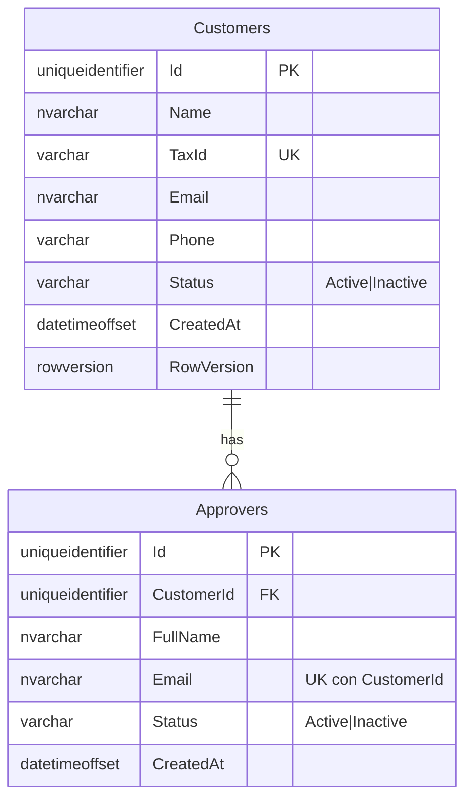
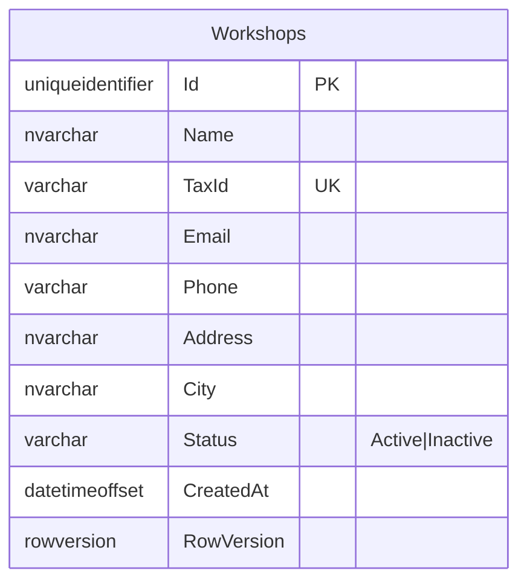
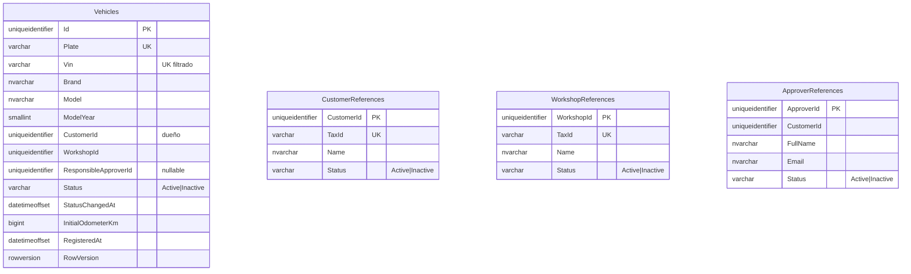
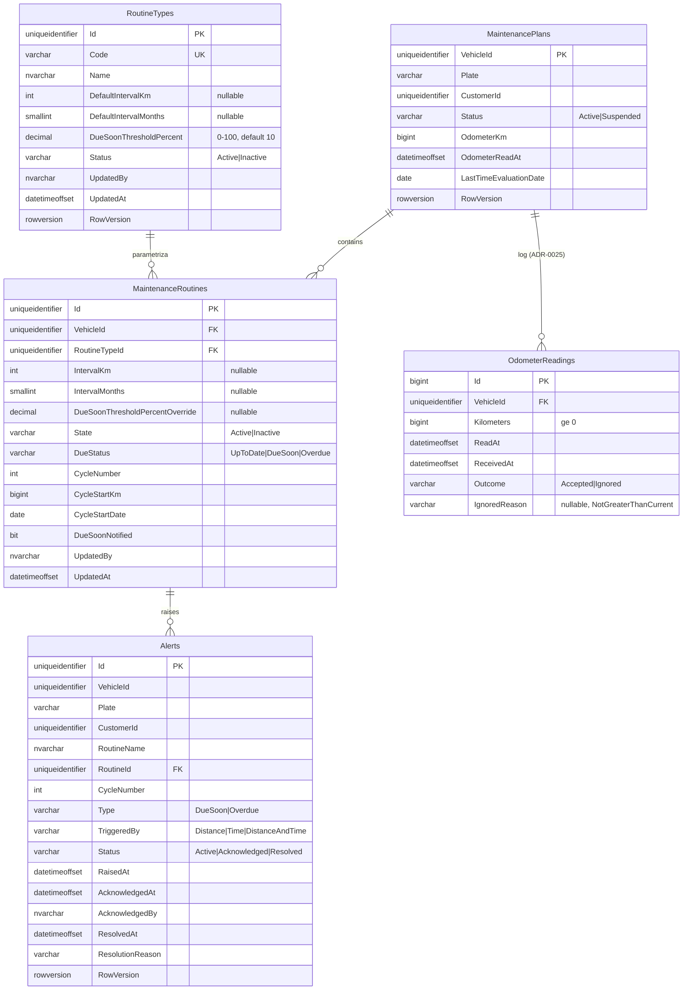
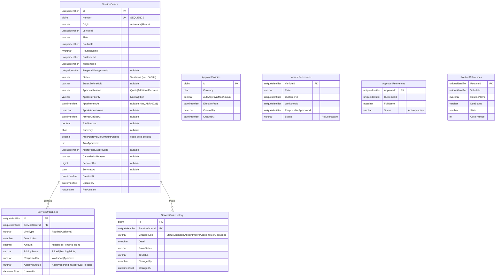
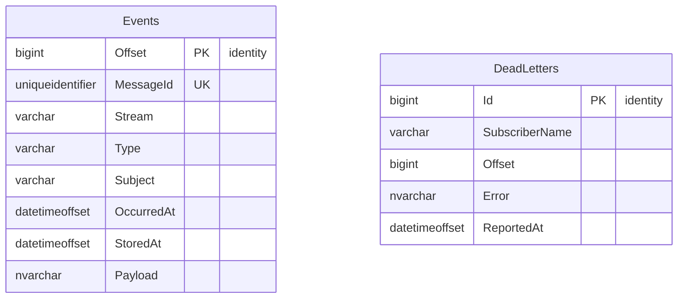
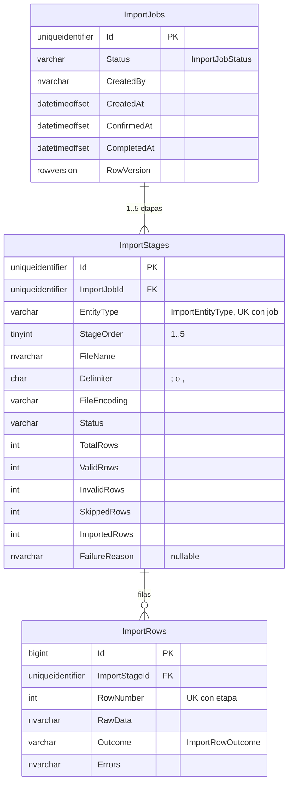
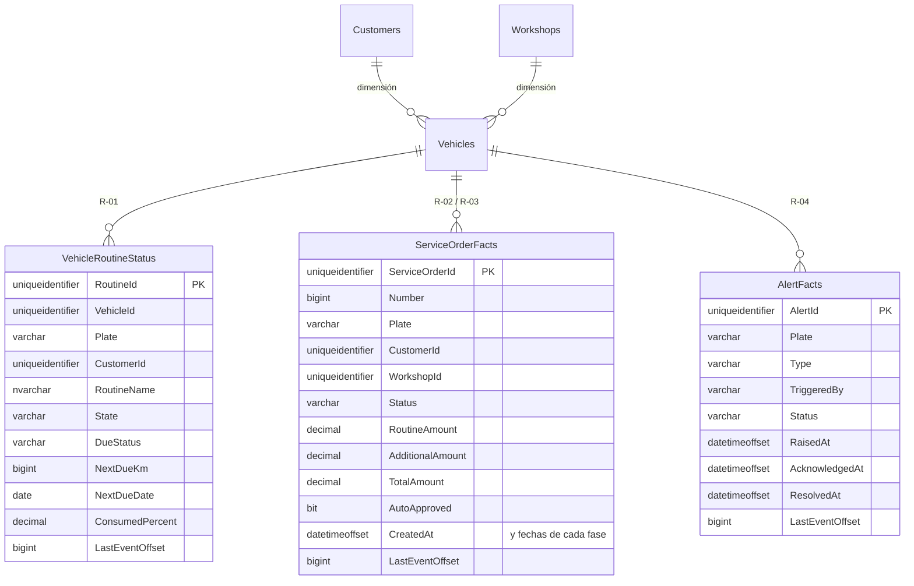

# Modelo de datos — RutaViva (SQL Server)

> Decisión de topología: [ADR-0013](../adr/adr-0013-data-sqlserver-schema-per-service.md). Parámetros: [ADR-0019](../adr/adr-0019-data-business-parameters-in-database.md). Estados de activación: [ADR-0020](../adr/adr-0020-arch-activation-states-suspension-cascade.md).
> Autenticación en local: [ADR-0028](../adr/adr-0028-data-local-windows-authentication.md). Lecturas de odómetro: [ADR-0025](../adr/adr-0025-data-odometer-reading-log.md). Mensajería: [ADR-0024](../adr/adr-0024-int-eventbus-signalr-sql-log.md).
> Script de referencia: [`database/rutaviva-reference-schema.sql`](database/rutaviva-reference-schema.sql). La fuente de verdad de la implementación son las migraciones de EF Core de cada servicio.

---

## 1. Principios de modelado

| # | Principio | Cómo se aplica |
|---|---|---|
| P-01 | **Un schema = un dueño** | Cada servicio accede solo a su schema con su propio usuario. No hay FK ni `JOIN` entre schemas |
| P-02 | **La tabla sigue al agregado** | Las raíces llevan `RowVersion` (rowversion como **propiedad sombra** de EF Core: la columna existe en la tabla, pero el dominio no la conoce). Las entidades internas (rutinas, aprobadores, líneas e historial) cuelgan de su raíz con FK y `ON DELETE CASCADE` |
| P-03 | **Referencias entre contextos por ID, sin FK** | La validación usa réplicas locales (`*References`) alimentadas por el EventBus |
| P-04 | **Las invariantes de negocio también viven en el motor** | Índices únicos filtrados y `CHECK` en los estados, intervalos, cotización, pausa y finalización |
| P-05 | **Dos dimensiones de estado, dos columnas** | Activación (`State` o `Status`) separada del estado de negocio (`DueStatus`) |
| P-06 | **Los parámetros son datos** | La matriz `RoutineTypes` y `ApprovalPolicies` (solo inserción, versionada por `EffectiveFrom`) |
| P-07 | **Todo estado es un enum** | En código, cada estado o clasificación es un `enum` de C# en el Domain de su servicio (catálogo en §5). En SQL Server se guarda por nombre (`varchar(20)` + `CHECK` con los mismos valores), nunca como `bit` ni como un entero mágico |
| P-08 | **Tiempo explícito** | `datetimeoffset(0)` para los instantes y `date` para las fechas de negocio |
| P-09 | **Mensajería confiable** | `OutboxMessages` y `EventCheckpoints` (suscriptor + último offset) en cada schema de negocio y en `reporting`; el log de eventos vive en el schema `eventbus` |
| P-10 | **Kilómetros como `bigint`** | Toda columna de kilometraje (`OdometerKm`, `CycleStartKm`, `ServicedKm`, `Kilometers`, `NextDueKm`) es `bigint` |

---

## 2. Diagramas entidad-relación por schema

### `customers`

> RutaViva también se registra como `Customer` (dueño de vehículos propios, A-11).

### `workshops`

### `fleet`

### `maintenance` (core)

`OdometerReadings` (ADR-0025) es un log de solo inserción fuera del agregado `MaintenancePlan`. Se inserta en la misma transacción que el cambio del plan. Las lecturas de vehículos desconocidos no se guardan. Índice `IX_OdometerReadings_VehicleId_ReceivedAt (VehicleId, ReceivedAt DESC)`.

**Valores calculados (no se almacenan)**: el próximo mantenimiento es `CycleStartKm + IntervalKm` y `DATEADD(month, IntervalMonths, CycleStartDate)`. El % efectivo es `COALESCE(Override, RoutineTypes.DueSoonThresholdPercent)`.

### `serviceorders` (core)

### Tablas técnicas (en cada schema de negocio)

`OutboxMessages` (Id = MessageId, Stream, EventType, Subject, Payload, OccurredAt, ProcessedAt, Attempts, LastError; índice filtrado `WHERE ProcessedAt IS NULL`) y `EventCheckpoints` (SubscriberName PK, LastOffset, UpdatedAt), en `customers`, `workshops`, `fleet`, `maintenance`, `serviceorders` y `reporting` (este último solo con `EventCheckpoints`).

### `eventbus` (log de eventos, ADR-0024)

> El EventBus no usa Outbox (es el log). `Events.Offset` es estrictamente creciente y global; la idempotencia por `MessageId` la resuelve el índice único.

---

### `imports` (DataImport, ADR-0022)

### `reporting` (Reporting, ADR-0023: proyecciones de lectura)

> Todas las tablas de proyección (`Customers`, `Workshops`, `Vehicles`, `VehicleRoutineStatus`, `ServiceOrderFacts` y `AlertFacts`) llevan `LastEventOffset bigint` además de `LastEventAt`.

> Las proyecciones **no tienen `CHECK` de enums**: son copias tolerantes (*tolerant reader*). Si el dueño agrega un valor nuevo, la proyección lo guarda sin fallar. Tampoco tienen FK: se actualizan por evento y en cualquier orden.

---

## 3. Decisiones de modelado clave

| # | Decisión | Justificación |
|---|---|---|
| D-01 | `UX_ServiceOrders_OneOpenPerRoutine` sobre `(VehicleId, RoutineId)` con `WHERE Status IN ('Created','Quoted','PendingApproval','Approved','OnSite','InProgress','OnHold')` | RN-3 en el motor, tanto para las órdenes automáticas como para las manuales. `OnHold` sigue contando como abierta |
| D-02 | `UX_Alerts_OnePerCycleAndType` sobre `(RoutineId, CycleNumber, Type)` | RN-2, «una sola vez por ciclo», aunque los parámetros cambien |
| D-03 | `RoutineTypes` como **matriz** de parámetros, con un ajuste opcional por rutina | A-02: el % se configura por tipo de rutina desde la web y el ajuste por vehículo es opcional |
| D-04 | `ApprovalPolicies` **solo de inserción**, con `EffectiveFrom` | A-06: historial auditable. La vigente es la última con `EffectiveFrom <= now` |
| D-05 | `ServiceOrders.AutoApprovalMaxAmountApplied` | La orden guarda una copia de la política al cotizar: los cambios aplican «desde la siguiente orden» |
| D-06 | `ServiceOrderLines` con `PricingStatus` | A-10: una cotización con líneas. Las adicionales pedidas por el aprobador quedan `PendingPricing` hasta que el taller les pone precio |
| D-07 | `CK_ServiceOrders_HoldData`: `OnHold` ⇔ `StatusBeforeHold` no nulo | A-18: la pausa siempre sabe a qué estado volver |
| D-08 | `MaintenanceRoutines.State` y `DueStatus` separados | ADR-0020: activación ≠ vencimiento |
| D-09 | `MaintenancePlans.Status` (`Active` o `Suspended`) | Refleja el estado del vehículo de Fleet, recibido por evento |
| D-10 | Réplicas `*References` mínimas en Fleet y ServiceOrders | Autorización (dueño o responsable), vehículo activo y creación manual (rutina `Overdue`) sin HTTP entre servicios |
| D-11 | `ServiceOrderHistory` con `ChangeType` | Trazabilidad del CRM: cambios de estado, cita registrada o reprogramada y servicios adicionales |
| D-16 | `AppointmentAt` y `AppointmentNotes`, con `CK_ServiceOrders_AppointmentRequired` | ADR-0021: la cita es un dato de la orden, obligatoria desde `OnSite`. No hay módulo de agendamiento |
| D-17 | `imports.ImportRows` guarda la fila original (`RawData`) y sus errores | Permite generar el CSV de errores descargable y auditar cada carga |
| D-18 | `reporting.*Facts` desnormalizadas, con las fechas de cada fase | Los reportes son consultas sobre una sola tabla, sin `JOIN` entre schemas. Los tiempos de ciclo se calculan con `DATEDIFF` sobre columnas locales |
| D-19 | `LastEventOffset` (y `LastEventAt` para auditoría) en cada proyección | Descarta los eventos fuera de orden: solo se aplica un evento si su `metadata.Offset` es mayor que `LastEventOffset`. Se usa el offset y no `OccurredAt` porque varios eventos de una misma transacción comparten fecha (ADR-0024) |
| D-20 | Permisos generados con un ciclo para los 8 schemas | Cada usuario tiene `GRANT` sobre su schema y `DENY` sobre los otros 7, sin repetir 56 líneas a mano |
| D-21 | `maintenance.OdometerReadings` como log fuera del agregado | ADR-0025: la regla RN-6 es visible en la UI y el agregado `MaintenancePlan` no crece |
| D-22 | `EventCheckpoints` en lugar de `InboxMessages` | ADR-0024: el suscriptor guarda el último offset procesado por transacción; no hay tabla de deduplicación por mensaje |
| D-23 | `RowVersion` como propiedad sombra | El dominio no conoce la persistencia: `ApplyRutaVivaConventions()` configura `rowversion` en toda raíz de agregado |
| D-12 | `ServiceOrders.Number` desde una `SEQUENCE` | Número legible `OS-000123` |
| D-13 | Índices de bandeja: alertas por estado, órdenes por taller y estado, y por dueño y estado | Vistas del CRM |
| D-14 | `ApprovalReason` y `ApprovalPriority` en la orden, más el índice filtrado `IX_ServiceOrders_ApprovalInbox` (`WHERE Status = 'PendingApproval'`) | A-15: la bandeja de aprobaciones muestra primero las de prioridad alta (servicios adicionales con el vehículo en sitio). El motivo decide si al aprobar la orden va a `Approved` o vuelve a `OnSite` |
| D-15 | `ServiceOrderLines.ApprovalStatus` | Al rechazar servicios adicionales se descartan solo esas líneas; la orden original sigue aprobada |

---

## 4. Seguridad de acceso por servicio

| Usuario | Permisos | Prohibido |
|---|---|---|
| `rutaviva_{service}_app` (×8: customers, workshops, fleet, maintenance, serviceorders, imports, reporting, eventbus) | `SELECT/INSERT/UPDATE/DELETE` en su `SCHEMA` | `DENY` explícito en los otros 7 schemas |
| `rutaviva_serviceorders_app` | Además, `UPDATE` sobre la SEQUENCE de números | — |
| Administrador local | DDL para las migraciones | No lo usan los servicios en ejecución |

> **ADR-0028 (autenticación de Windows en local):** en local los servicios se conectan con `Trusted_Connection=True`, sin contraseñas en archivos. Los usuarios `rutaviva_{schema}_app` se siguen creando con el script como control verificable (una prueba con `EXECUTE AS USER` comprueba que cada uno solo accede a su schema). Un entorno con modo mixto o en la nube cambia solo `ConnectionStrings:RutaViva`.

---

## 5. Catálogo de enums

Cada enum vive en el proyecto `Domain` del servicio dueño. Las réplicas (`*References`) usan **su propia copia** del enum en el servicio consumidor, porque no se comparten tipos de dominio entre servicios (ADR-0010).

| Servicio | Enum | Valores | Columna |
|---|---|---|---|
| Customers | `CustomerStatus` | `Active`, `Inactive` | `customers.Customers.Status` |
| Customers | `ApproverStatus` | `Active`, `Inactive` | `customers.Approvers.Status` |
| Workshops | `WorkshopStatus` | `Active`, `Inactive` | `workshops.Workshops.Status` |
| Fleet | `VehicleStatus` | `Active`, `Inactive` | `fleet.Vehicles.Status` |
| Maintenance | `RoutineTypeStatus` | `Active`, `Inactive` | `maintenance.RoutineTypes.Status` |
| Maintenance | `MaintenancePlanStatus` | `Active`, `Suspended` | `maintenance.MaintenancePlans.Status` |
| Maintenance | `RoutineState` | `Active`, `Inactive` | `maintenance.MaintenanceRoutines.State` |
| Maintenance | `RoutineDueStatus` | `UpToDate`, `DueSoon`, `Overdue` | `maintenance.MaintenanceRoutines.DueStatus` |
| Maintenance | `AlertType` | `DueSoon`, `Overdue` | `maintenance.Alerts.Type` |
| Maintenance | `AlertTrigger` | `Distance`, `Time`, `DistanceAndTime` | `maintenance.Alerts.TriggeredBy` |
| Maintenance | `AlertStatus` | `Active`, `Acknowledged`, `Resolved` | `maintenance.Alerts.Status` |
| Maintenance | `OdometerReadingOutcome` | `Accepted`, `Ignored` | `maintenance.OdometerReadings.Outcome` |
| Maintenance | `OdometerReadingIgnoredReason` | `NotGreaterThanCurrent` | `maintenance.OdometerReadings.IgnoredReason` |
| Maintenance | `AlertResolutionReason` | `RoutineRestarted`, `EscalatedToOverdue`, `ParametersChanged`, `RoutineDeactivated` | `maintenance.Alerts.ResolutionReason` |
| ServiceOrders | `ServiceOrderStatus` | `Created`, `Quoted`, `PendingApproval`, `Approved`, `OnSite`, `InProgress`, `OnHold`, `Completed`, `Cancelled` | `Status`, `StatusBeforeHold`, `FromStatus`, `ToStatus` |
| ServiceOrders | `ServiceOrderOrigin` | `Automatic`, `Manual` | `serviceorders.ServiceOrders.Origin` |
| ServiceOrders | `CancellationReason` | `QuoteRejected`, `CancelledByCustomer` | `serviceorders.ServiceOrders.CancellationReason` |
| ServiceOrders | `ApprovalReason` | `Quote`, `AdditionalServices` | `serviceorders.ServiceOrders.ApprovalReason` |
| ServiceOrders | `ApprovalPriority` | `Normal`, `High` | `serviceorders.ServiceOrders.ApprovalPriority` |
| ServiceOrders | `ServiceLineType` | `Routine`, `Additional` | `serviceorders.ServiceOrderLines.LineType` |
| ServiceOrders | `PricingStatus` | `Priced`, `PendingPricing` | `serviceorders.ServiceOrderLines.PricingStatus` |
| ServiceOrders | `ServiceLineApprovalStatus` | `Approved`, `PendingApproval`, `Rejected` | `serviceorders.ServiceOrderLines.ApprovalStatus` |
| ServiceOrders | `ServiceLineRequester` | `Workshop`, `Approver` | `serviceorders.ServiceOrderLines.RequestedBy` |
| ServiceOrders | `ServiceOrderChangeType` | `StatusChanged`, `AppointmentScheduled`, `AppointmentRescheduled`, `AdditionalServiceAdded` | `serviceorders.ServiceOrderHistory.ChangeType` |
| DataImport | `ImportJobStatus` | `Validating`, `PendingConfirmation`, `Importing`, `Completed`, `CompletedWithErrors`, `Failed` | `imports.ImportJobs.Status` |
| DataImport | `ImportEntityType` | `Workshops`, `Customers`, `Approvers`, `Vehicles`, `Routines` | `imports.ImportStages.EntityType` |
| DataImport | `ImportStageStatus` | `Pending`, `Validated`, `Imported`, `Failed` | `imports.ImportStages.Status` |
| DataImport | `FileEncoding` | `Utf8`, `Utf8Bom`, `Windows1252` | `imports.ImportStages.FileEncoding` |
| DataImport | `ImportRowOutcome` | `Valid`, `Invalid`, `Skipped`, `Imported`, `Failed` | `imports.ImportRows.Outcome` |
| Reporting | `ReportCode` | `FleetMaintenanceStatus`, `ServiceOrders`, `MaintenanceCosts`, `AlertsAttention` | (parámetro de la API) |
| Reporting | `ReportFormat` | `Xlsx`, `Csv` | (parámetro de la API) |

### Reglas para los enums

| ID | Regla |
|---|---|
| E-01 | Valores numéricos **explícitos y empezando en 1** (`Active = 1`). `default(T)` = 0 no es un estado válido, así que un valor sin asignar se detecta |
| E-02 | Persistencia por **nombre**: `HasConversion<string>().HasMaxLength(20)` en cada `IEntityTypeConfiguration`. Agregar un valor no reordena datos y la BD es legible en la demo |
| E-03 | El `CHECK` de cada columna lista **exactamente** los valores del enum. Una prueba de integración compara `Enum.GetNames<T>()` con la definición del `CHECK` en `sys.check_constraints` |
| E-04 | En los contratos del EventBus y en la API REST, los enums se serializan **como texto** (`JsonStringEnumConverter`). Agregar un valor al final es compatible. Renombrar o quitar uno exige una versión nueva del contrato (`.v2`) |
| E-05 | En Angular, cada enum tiene un espejo como tipo literal de TypeScript (`type ServiceOrderStatus = 'Created' \| ...`) en `core/models`, más un mapa de etiquetas en español (`En sitio`, `En proceso`, `Finalizada`) en un solo archivo |
| E-06 | Las reglas no se basan en comparar el orden numérico de los enums (`status < InProgress`). Se usan conjuntos explícitos en el dominio, por ejemplo `CancellableStatuses` |
