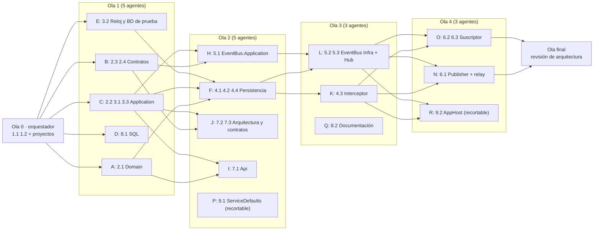

# Plan de ejecución en paralelo con agentes

Documenta qué tareas de `foundation-platform` se implementan al mismo tiempo con subagentes y cuáles van en secuencia. Los IDs de tarea son los de `tasks.md`. Generado con la skill `satrack-openspec-parallel-harness`.

## Reglas para todos los agentes

1. **Propiedad exclusiva de archivos.** Dos agentes simultáneos nunca editan el mismo archivo. Los `.csproj`, `RutaViva.slnx` y `Directory.*.props` son del orquestador.
2. **Contratos primero.** Interfaces y entidades antes que implementaciones y consumidores.
3. **Sin compilar en paralelo en el mismo árbol** (modo A). La compilación y las pruebas las corre la compuerta.
4. **Sin commits ni ramas.**
5. **Restricciones del proyecto:** ver `rules` de cada ola (sin `var`, sin comentarios, constantes, guard clauses, dominio rico, SOLID, CQRS, nombres de ADR-0026).
6. **Presupuesto de contexto.** Ningún agente en rojo según `estimate-context.mjs`.
7. **Comunicación en estrella.** Contratos por nombre fijo (design.md § Registro de contratos), firmas de olas anteriores por `handoff.json`, bloqueos con `status: "blocked"`.

## Roles de agente

| Rol | Modelo | Esfuerzo | Skill | Uso |
|---|---|---|---|---|
| Orquestador (sesión principal) | Opus | alto | `satrack-openspec-usage` | Ola 0, proyectos, compuertas, marcas en `tasks.md` |
| `impl-domain` / `impl-application` / `impl-infra` | Sonnet | medio / alto | `satrack-dotnet-patterns` | Código C# y sus pruebas |
| `impl-contracts` | Sonnet | medio | Ninguna | Records de contratos |
| `impl-sql` / `impl-docs` | Sonnet | bajo | Ninguna | Scripts SQL y documentación |
| `gate-runner` | Haiku | bajo | Ninguna | Ejecuta `verify-wave.sh` |
| `wave-verifier` | Sonnet | medio | `satrack-sonarqube-quality-gates` (bajo demanda) | Criterios de `tasks.md` |

## Grafo de dependencias



Ruta crítica: 2.1/2.2 → 4.1 → 4.3 → 5.2/5.3 → 6.2/6.3.

## Ola 0 ejecutable (Paso 1b)

| # | Comprobación | Resultado |
|---|---|---|
| 1 | Restore limpio | OK desde nuget.org. Versiones fijadas en `Directory.Packages.props`: `Microsoft.*` 10.0.15 (ya existe 11.0.0; se mantiene .NET 10 por los ADRs), Resilience 10.11.0, xUnit v3 4.0.3 |
| 2 | Línea base | Proyecto *greenfield*: build en verde y 0 pruebas. Tareas 1.1 y 1.2 hechas por el orquestador y marcadas |
| 3 | Compuerta en seco | `VERIFY-WAVE PASSED`. Ajustes: `.claude/harness/` en `owned-files.txt`; conteo de pruebas sin distinguir mayúsculas y sin códigos ANSI (Microsoft.Testing.Platform imprime `total:`) y `DOTNET_CLI_UI_LANGUAGE=en` |
| 4 | Humo de pruebas | Proyecto desechable con EF Core contra el SQL local: BD creada y borrada, índice único filtrado y `rowversion` verificados (2/2). Hallazgos: `global.json` con `test.runner = Microsoft.Testing.Platform`; `using Xunit` global; analizador xUnit1051 (pasar `TestContext.Current.CancellationToken`); **IDE0008** (no IDE0007) prohíbe `var`; Verify exige licencia → snapshots propios (ADR-0027); proyectos vacíos con `--ignore-exit-code 8` |
| 5 | Repositorio sin versionar | Resuelto con `git init` y commits de línea base (`0d5a3b6`, `f7fbfb8`). No hace falta foto de hashes |
| 6 | Arranque local | No aplica a este change (sin E2E) |

Pruebas de la línea base (valor de `--baseline`): 0. Cada ola usa como línea base el total de la ola anterior.

## Ola 0: secuencial (orquestador)

| Tarea | Responsable | Por qué no es paralela |
|---|---|---|
| 1.1, 1.2 | Orquestador | Andamiaje de menos de 5 pasos y archivos compartidos (`.slnx`, props) |
| Creación de los 16 proyectos del change | Orquestador | `RutaViva.slnx` y los `.csproj` son archivos compartidos |

## Ola 1: 5 agentes en paralelo

| Agente | Rol | Tareas | Archivos propios | Consume | Contexto estimado | Depende de | Complejidad |
|---|---|---|---|---|---|---|---|
| A | `impl-domain` | 2.1 | `src/BuildingBlocks/RutaViva.BuildingBlocks.Domain/`, `tests/BuildingBlocks/RutaViva.BuildingBlocks.UnitTests/Domain/` | — | 42 240 (verde) | Ola 0 | Media |
| B | `impl-contracts` | 2.3, 2.4 | `src/Contracts/RutaViva.IntegrationContracts/` | — | 49 044 (verde) | Ola 0 | Media |
| C | `impl-application` | 2.2, 3.1, 3.3 | `src/BuildingBlocks/RutaViva.BuildingBlocks.Application/`, `tests/BuildingBlocks/RutaViva.BuildingBlocks.UnitTests/Application/` | `Result`, `Error` (A, nombre fijo); `IIntegrationEvent`, `EventMetadata`, `Bulk*` (B, nombre fijo) | 56 596 (verde) | Ola 0 | Alta |
| D | `impl-sql` | 8.1 | `deploy/local/sql/` | — | 27 136 (verde) | Ola 0 | Baja |
| E | `impl-infra` | 3.2 | `src/BuildingBlocks/RutaViva.BuildingBlocks.Infrastructure/Time/`, `tests/RutaViva.Testing.Fixtures/`, `tests/BuildingBlocks/RutaViva.BuildingBlocks.UnitTests/Infrastructure/`, `tests/BuildingBlocks/RutaViva.BuildingBlocks.IntegrationTests/Testing/` | `IClock` (C, nombre fijo) | 39 348 (verde) | Ola 0 | Media |

- C es el agente con más carga y está en la ruta crítica.
- **Compuerta 1:** `verify-wave.sh` completo + `wave-verifier`.

## Ola 2: 5 agentes (se estima antes de lanzar)

| Agente | Rol | Tareas | Archivos propios (previstos) | Consume |
|---|---|---|---|---|
| F | `impl-infra` | 4.1, 4.2, 4.4 | `Infrastructure/Persistence/`, `Infrastructure/Messaging/`, `IntegrationTests/Persistence/` | Ola 1 A, C, E |
| H | `impl-application` | 5.1 | `src/Platform/EventBus/RutaViva.EventBus.Application/`, `tests/Platform/RutaViva.EventBus.Application.UnitTests/` | Ola 1 B, C |
| I | `impl-infra` | 7.1 | `src/BuildingBlocks/RutaViva.BuildingBlocks.Api/`, `IntegrationTests/Api/` | Ola 1 A, C |
| J | `impl-tests` | 7.2, 7.3 | `tests/RutaViva.Architecture.Tests/`, `tests/RutaViva.IntegrationContracts.Tests/` | Ola 1 B |
| P | `impl-infra` | 9.1 (recortable) | `src/Platform/RutaViva.ServiceDefaults/` (proyecto creado por el orquestador antes de la ola) | — |

## Ola 3: 3 agentes

| Agente | Rol | Tareas | Archivos propios (previstos) | Consume |
|---|---|---|---|---|
| K | `impl-infra` | 4.3 | `Infrastructure/DomainEvents/`, `IntegrationTests/DomainEvents/` | Ola 2 F |
| L | `impl-infra` | 5.2, 5.3 | `src/Platform/EventBus/RutaViva.EventBus.Infrastructure/`, `src/Platform/EventBus/RutaViva.EventBus.Hub/`, `tests/Platform/RutaViva.EventBus.Hub.IntegrationTests/` | Ola 2 H |
| Q | `impl-docs` | 8.2 | `docs/architecture/data-model.md`, `docs/architecture/database/rutaviva-reference-schema.sql` | Registro de contratos |

## Ola 4: 3 agentes

| Agente | Rol | Tareas | Archivos propios (previstos) | Consume |
|---|---|---|---|---|
| N | `impl-infra` | 6.1 | `src/BuildingBlocks/RutaViva.BuildingBlocks.EventBus.Client/Publishing/`, `IntegrationTests/EventBus/Publishing/` | Ola 2 F, Ola 3 L |
| O | `impl-infra` | 6.2, 6.3 | `src/BuildingBlocks/RutaViva.BuildingBlocks.EventBus.Client/Subscribing/`, `IntegrationTests/EventBus/Subscribing/` | Ola 2 F, Ola 3 L |
| R | `impl-infra` | 9.2 (recortable) | `src/Platform/RutaViva.AppHost/` (proyecto creado por el orquestador) | Ola 3 L |

## Ola final: secuencial

| Tarea | Responsable | Por qué no es paralela |
|---|---|---|
| Revisión de arquitectura del diff completo | Orquestador con `satrack-software-architect` | Necesita la visión completa |
| `openspec validate foundation-platform --strict` y commit | Orquestador | Cierre del change |

## Resumen

| Ola | Agentes simultáneos | Tareas |
|---|---|---|
| 0 | 0 | 1.1, 1.2 |
| 1 | 5 | 2.1, 2.2, 2.3, 2.4, 3.1, 3.2, 3.3, 8.1 |
| 2 | 5 | 4.1, 4.2, 4.4, 5.1, 7.1, 7.2, 7.3, 9.1 |
| 3 | 3 | 4.3, 5.2, 5.3, 8.2 |
| 4 | 3 | 6.1, 6.2, 6.3, 9.2 |

Máximo de agentes simultáneos: 5.

## Protocolo de comunicación

- Registro de contratos: `design.md` § D-02, D-03, D-05, D-07 y § Registro de contratos.
- Handoff: `.claude/harness/handoff.json`, actualizado con `persist-wave.mjs` al cerrar cada ola.
- Resultados: `.claude/harness/waves/wave-<n>.result.json`.
- Compactación del orquestador: después de la Ola 2, o cuando el contexto supere el 60 %.

## Modo de aislamiento

**A — mismo árbol, compilación centralizada**, elegido por el usuario. Los agentes no compilan; la compuerta compila y prueba una vez por ronda.

## Harness

- Compuerta: `bash .claude/harness/verify-wave.sh --change foundation-platform --owned .claude/harness/owned-files.txt --build "dotnet build RutaViva.slnx" --test "dotnet test --solution RutaViva.slnx --no-build" --baseline <n>`
- Motor: un workflow por ola con `.claude/harness/wave-workflow.js`, máximo 2 reintentos por tarea.
- Barrera: hook `SubagentStop` no registrado (la compuerta de cada workflow ya cubre los chequeos rápidos y el hook afectaría a otros agentes de la sesión).
- Tareas humanas (pausas): ninguna en este change.

## Estimación de costo

```
Olas: 4 | Agentes de implementación: 16 | Compuertas: 4 (+ reintentos) | Verificadores: 4
Reintentos máximos: 2 × tarea | Modelos: Haiku (compuertas), Sonnet (implementación y verificación), Opus (orquestador)
```
