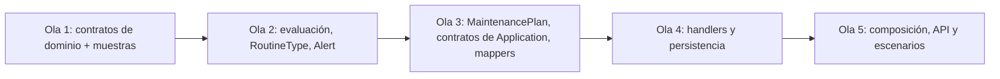

# Ejecución paralela: maintenance-core

Modo A (mismo árbol, solo el orquestador compila). Compuerta: `verify-wave.sh` con build y pruebas de toda la solución; la línea base de cada ola es el total de pruebas de la ola anterior. Recorte aprobado: la 11.1 (Reqnroll) queda fuera.

## Ola 0 (orquestador)

| Tarea | Resultado |
|---|---|
| 1.1 | 7 proyectos creados con las referencias de Clean Architecture, agregados a `RutaViva.slnx`. Las pruebas de arquitectura referencian `src/**/*.csproj` con comodín, así que cubren el servicio sin cambios (76 en verde) |
| Diseño | Se quitó `IHasRowVersion` de los diseños de los changes (foundation 4.5 lo reemplazó por la propiedad sombra) |

## Olas

| Ola | Agente | Tareas | Archivos propios |
|---|---|---|---|
| 1 | M | 2.1, 2.2 | `{D}/Common/`, enums y `ValueObjects/` de `{D}/Plans`, `{D}/Alerts`, `{D}/RoutineTypes` (sin `Events/`), `{TD}/ValueObjects/` |
| 1 | V | 2.3 | `{D}/Plans/Events/`, `{D}/Alerts/Events/`, `{D}/RoutineTypes/Events/` |
| 1 | S | 10.1, 10.2 | `samples/` |
| 2 | E | 3.1, 3.2 | `{D}/Plans/Evaluation/`, `{TD}/Evaluation/` |
| 2 | R | 3.3 | `{D}/RoutineTypes/` (agregado), `{TD}/RoutineTypes/` |
| 2 | L | 4.4 | `{D}/Alerts/` (agregado), `{TD}/Alerts/` |
| 3 | P | 4.1, 4.2, 4.3 | `{D}/Plans/` (agregados), `{TD}/Plans/` |
| 3 | C | 5.1 | `{A}/Abstractions/` y commands, queries y DTOs |
| 3 | O | 6.8 | `{A}/IntegrationEvents/Outbound/`, `{TA}/IntegrationEvents/Outbound/` |
| 4 | T, U, V, I, J | 6.1 a 6.7, 6.9, 7.1 a 7.3 | Handlers por carpeta de feature e infraestructura de persistencia |
| 5 | K, W, X | 7.4, 8.1, 8.2, 9.1, 9.2 | Composición, API y escenarios de punta a punta |

Ruta crítica: 2.x → 3.1/3.2 → 4.1–4.3 → 6.x/7.x → 8.x → 9.x.
